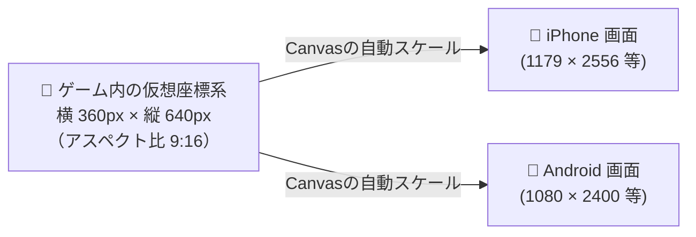
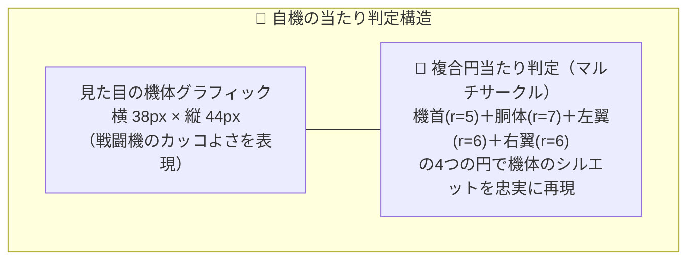
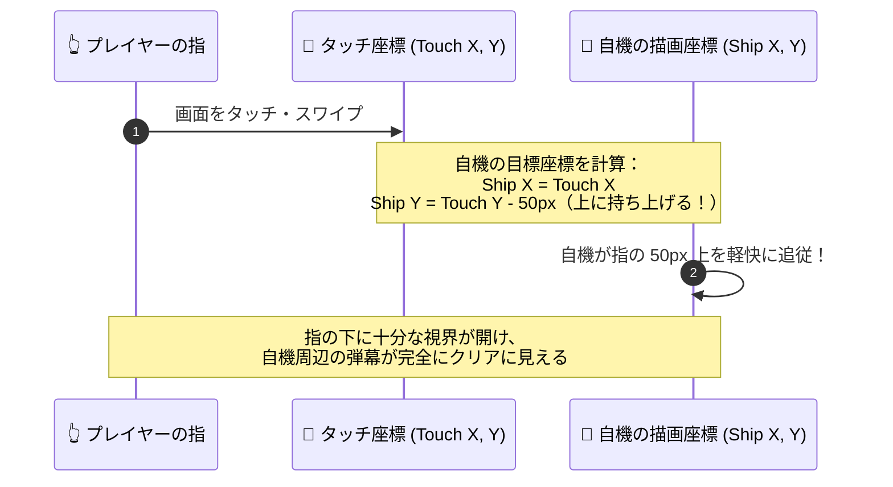

# スマホ画面・キャラクターサイズ＆操作性設計ガイド（04_screen-and-character-sizing.md）

> **位置づけ**: スマホ縦画面（9:16）において、ゲームの「見やすさ」「避けやすさ」「操作の気持ちよさ（手触り）」を保証するための画面比率・キャラクターサイズ・当たり判定・タッチ操作の絶対基準仕様書です。

---

## 1. 基準仮想解像度（論理解像度）の定義

スマホは機種ごとに物理的な画面解像度が異なります（iPhone 15: `1179×2556`、Galaxy: `1080×2340` 等）。
そのため、ゲーム内部では **「固定の仮想座標系」** を1つ定め、実行時にスマホ画面の大きさに応じて自動拡大・縮小（アスペクト比固定レターボックス / フィット）する方式を採用します。



### なぜ `360 × 640` なのか？
1. **業界のデファクト基準**: Web・モバイルUIデザインにおける最小公約数的な幅であり、どのスマホでも美しくスケーリングできる。
2. **計算負荷の軽さ**: 小さな数値で整数演算しやすいため、大量の弾幕や当たり判定の計算が非常に高速になる。
3. **Stitch デザイン定義（`DESIGN.md`）との完全一致**: 9:16 の縦長戦闘回廊（Vertical Combat Corridor）設計にそのまま合致する。

---

## 2. 画面レイアウトの縦3分割設計

スマホ縦画面を快適に遊ぶため、画面を縦方向に以下の **3つの機能エリア** に分割します。

```text
┌───────────────────────────────────────┐ 0px
│ ［上部 HUD エリア］（高さ 50px）       │
│  スコア、残機数(3機)、HPゲージ、ボム   │
├───────────────────────────────────────┤ 50px
│                                       │
│ ［メイン戦闘エリア］（高さ 約350px）  │
│  ・敵の編隊出現                       │
│  ・ボスの配置・部位ギミック           │
│  ・敵弾幕の展開                       │
│  ※指が入ってこないため視界クリア！   │
│                                       │
├───────────────────────────────────────┤ 400px
│                                       │
│ ［プレイヤータッチ＆回避エリア］      │
│  （高さ 約240px）                     │
│  ・自機が主に動き回る空間             │
│  ・指をスワイプする操作領域           │
│                                       │
└───────────────────────────────────────┘ 640px
```

- **上部 HUD エリア（0〜50px）**:
  - スマホのカメラノッチ（切り欠き）やセーフエリアを考慮し、重要情報を常時表示。
- **メイン戦闘エリア（50〜400px）**:
  - 敵の出現や弾幕が広がる空間。プレイヤーの指で遮られないため、弾幕の軌道をしっかり視認できる。
- **操作・回避エリア（400〜640px）**:
  - プレイヤーが親指などで画面を操作するメインスペース。

---

## 3. キャラクター・弾丸のサイズ設計基準

### 見た目のサイズ（Sprite Size） vs 当たり判定（Hitbox）
シューティングゲームにおける最も重要な設計原則は、**「見た目はかっこよく大きく、当たり判定は針の穴のように小さく」** することです。



### オブジェクト別 寸法一覧表（横 360 × 縦 640 基準）

| 分類 | オブジェクト名 | 画面幅比率 | 描画サイズ（幅×高） | 当たり判定（形状・サイズ） | 特徴・ゲームデザイン上の意図 |
| :--- | :--- | :--- | :--- | :--- | :--- |
| **自機** | VF-01 VALKYRIE 等 | 約 10〜12% | **38px × 44px** | **複合円（4つの円）**<br>機首 r=5 / 胴体 r=7 / 左右翼 r=6 | 機体シルエットに沿った正確な当たり判定。何もない空間では当たらず、翼や機首にかすれば被弾。 |
| **ザコ敵** | 偵察小型ドローン等 | 約 6〜8% | **22px × 26px** | 円（半径 9px） | 1画面に5〜10機が編隊で出現しても邪魔にならないコンパクトサイズ。一撃〜数発で撃破。 |
| **中型敵** | 重装甲ガンシップ等 | 約 15〜20% | **60px × 65px** | 円（半径 24px） | 画面中央に居座るタフな敵。破壊すると大量のスコアやパワーアップアイテムを放出。 |
| **ボス** | GOLIATH 〜 DEUS EX | 約 50〜75% | **180px〜270px**<br>（高 120〜180px） | 複合判定<br>（弱点コア＋左右砲台） | 画面上部を堂々と制圧する威圧感。弱点コア（判定小）の周りに破壊可能なサブ部位を配置。 |
| **自機弾** | 通常弾 / レーザー | 約 1〜2% | 幅 4〜6px<br>長さ 16〜24px | 矩形（幅 4px × 高 16px） | 撃った爽快感と直進性を強調する細長い光芒。 |
| **自機弾** | ミサイル / ホーミング | 約 2〜3% | 幅 8px × 高 14px | 円（半径 5px） | 煙を吹きながら敵に向かって旋回追尾する弾体。 |
| **敵弾** | 小型通常弾（赤・紫） | 約 2〜3% | 直径 **8px 〜 10px** | **円（半径 3px）** | 判定より少し大きめに発光（Glow）させて見切りやすくする。 |
| **敵弾** | 大型エネルギー弾 | 約 4〜6% | 直径 **16px 〜 20px** | 円（半径 7px） | ボスが放つ高密度弾や低速破壊不可弾。 |

---

## 4. スマホSTG特有の「指隠れ防止（タッチオフセット）」設計

スマホでSTGを遊ぶ際、最大のストレスは **「自分の指で自機や弾幕が隠れて死ぬこと」** です。
これを完全に解消するため、以下の **タッチ追従＆オフセットアルゴリズム** を標準実装します。



### 実装のポイント
1. **オフセット距離**: 指の接触面（約 30〜40px）より確実に上に逃がすため、**`50px` 上方**に設定します。
2. **画面端でのクリッピング（画面外飛び出し防止）**:
   - 自機が画面の左右・上下の壁を突き抜けないよう、常に以下のクランプ（制限）処理をかけます：
     - `Ship X` : `自機幅の半分` 〜 `360 - 自機幅の半分`
     - `Ship Y` : `上部HUDの高さ(50px)` 〜 `640 - 自機高さの半分`
3. **滑らかな追従（Lerp / 補間移動）**:
   - 指の急激なワープ移動で自機が一瞬で飛ぶと不自然なため、自機は毎フレーム「指の目標位置」に向かって少しだけ滑らかに補間移動（Lerp係数 0.3〜0.5 等）させると、操作感が劇的に気持ちよくなります。

---

## 5. Stitch素材との寸法マッピング

本フォルダ内の [`images/stitch/`](../images/stitch/) にある SVG 素材を、本仕様書の寸法にそのまま流用します。

- **自機（`images/stitch/_2/code.html` 内の SVG）**:
  - `viewBox="0 0 160 120"` の SVG データを、Canvas 上で `幅 38px × 高さ 44px` に縮小描画。
- **敵機 8種（`images/stitch/_1/code.html` 内の SVG）**:
  - ドローン系は `22×26px`、重装甲ガンシップは `60×65px` にマッピング。
- **ボス 10種（`images/stitch/stage_1_10/code.html` 内のワイヤーフレーム SVG）**:
  - ステージ1〜10の各ボス形状を `幅 200〜260px` のスケールで描画。

---

## 6. まとめとチェックリスト

ゲーム実装時、以下の項目を満たしているかをテストします：

- [ ] 画面がどのスマホでも `360 × 640` の比率を保って歪みなく表示されているか？
- [ ] 自機を指で触ったとき、指の真下ではなく指の少し上（約50px上）を飛んでいるか？
- [ ] 自機の見た目（38px）に対して、敵弾に当たるコア判定が中心の 2〜3px になっているか？
- [ ] 画面上部 50px の HUD に敵や自機が重なって文字が見えなくならないか？
- [ ] 敵弾が背景の星空（黒・紺）に溶け込まず、赤・ピンク・水色に強く発光して見やすいか？
