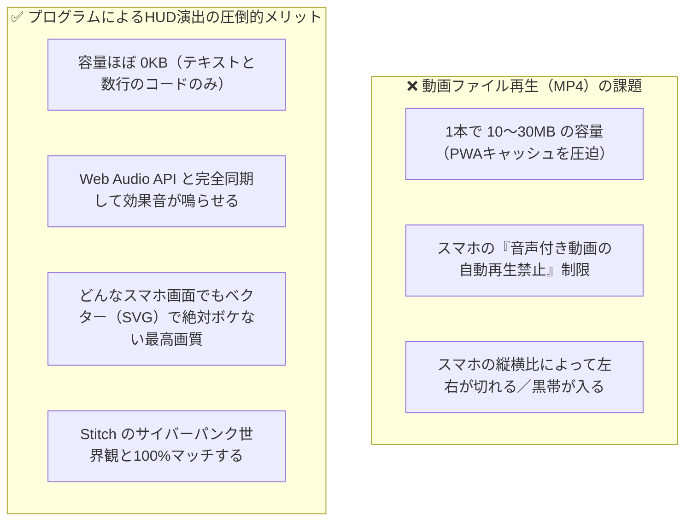
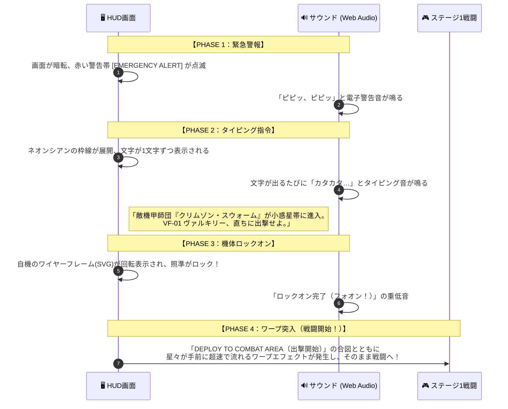

# プロローグ・エピローグ演出設計ガイド（05_cutscene-and-story-presentation.md）

> **位置づけ**: 本ドキュメントは、ゲームのプロローグ（出撃前）、各ステージクリア後の達成感イベント、およびステージ10クリア時の最終エピローグを、Web/スマホ環境で最も軽量かつ高臨場感に実現するための演出仕様・実装技術ガイドです。

---

## 1. 専門用語：HUD（ヘッドアップディスプレイ）とは？

- **HUD（Head-Up Display / ヘッドアップディスプレイ）**:
  - もともとは**戦闘機のコックピット**で、パイロットが下を向いて計器を見なくてもいいように、**「前方の透明なガラス板に速度・高度・照準（レティクル）などの飛行データを光で直接投影する仕組み」** のことです。
  - ゲームの世界では、ゲーム画面の手前に重ねて表示される **「残機・HPゲージ・スコア・ミニマップ・警告表示」** などのUI全般を「HUD」と呼びます。
  - 今回採用する **「HUDブリーフィング演出」** は、プレイヤーがまるで戦闘機のコックピットに座り、戦術コンピューターのスクリーン越しに緊急指令を受け取っているかのような臨場感を味わえる演出手法です。

---

## 2. 演出方式の選定理由（なぜ動画ではなくプログラム演出なのか？）

プロローグやエピローグを実装するにあたり、「動画ファイル（MP4）」ではなく **「プログラム制御によるHUDブリーフィング（In-Engine演出）」** を採用した技術的理由は以下の4点です。



---

## 3. プロローグ演出：軍事作戦ブリーフィングの流れ

出撃前のプロローグは、以下のステップでシームレスに戦闘へと繋ぎます。



### スキップ機能の重要性
- ゲームを何度も遊ぶプレイヤーのために、画面のどこかを1回タップ（または「SKIP ［>>］」ボタンを押す）したら、**文字のタイピングを即座に全表示**、もう1回タップしたら**即座に戦闘開始**できるように設計します。

---

## 4. ステージクリア演出：達成感とスコア集計

各ステージのボスを撃破した直後の演出です。プレイヤーのテンションを一気に高めます。

```text
┌───────────────────────────────────────┐
│           STAGE 01 CLEAR!             │ ← 巨大な金文字でドカンと表示
│      MISSION STATUS: SUCCESSFUL       │
├───────────────────────────────────────┤
│                                       │
│   ENEMY DESTROYED :  100%             │
│   TIME BONUS      :  +50,000 PTS      │ ← 1行ずつ数字が「ドゥルルル…」と
│   NO DAMAGE BONUS :  +100,000 PTS     │   ロールアップ音とともに加算
│                                       │
│   TOTAL SCORE     :  1,250,000 PTS    │
│   CLEAR RANK      :  [ SSS ]          │ ← 最後にド派手にランクスタンプ！
│                                       │
├───────────────────────────────────────┤
│        [ TAP TO NEXT SECTOR ]         │
└───────────────────────────────────────┘
```

1. **ボス撃破のスローモーション**:
   - ボスのHPがゼロになった瞬間、ゲーム全体の動きが0.5秒間スローモーションになり、白光フラッシュとともに大爆発。
2. **スコアのカウントアップ（ロールアップ演出）**:
   - 数字が一瞬でポンと出るのではなく、「0 → 50000」と数字が高速で回転しながら増える演出により、アーケードゲームのような爽快な達成感を生み出します。
3. **ランク評価（C / B / A / S / SSS）**:
   - クリアタイムや被弾回数に応じてランクスタンプが押され、「もう1回やって最高ランクを取りたい！」というやり込み意欲を刺激します。

---

## 5. 最終エピローグ演出（ステージ10クリア時）

全10ステージを走り切ったプレイヤーだけが見られる特別なフィナーレです。

1. **第10階層「神性機動超越生命体 DEUS EX COSMOS」の消滅**:
   - 画面全体を覆う極彩色の粒子が宇宙の彼方へ消え去り、静寂が訪れる。
2. **星々の帰還と凱旋テキスト**:
   - 穏やかな宇宙の星空を背景に、地球防衛艦隊からの感謝と帰還を促すメッセージがゆっくりとフェードイン・フェードアウト。
3. **スタッフロール ＆ 全戦績リザルト**:
   - 全10ステージのトータルスコア、倒した敵の総数、総プレイ時間が、余韻を残すエンディングBGMとともにスクロール。
   - 最後に自機が地球へ向かってゆっくりと飛び去り、「THANK YOU FOR PLAYING」で締めくくられます。

---

## 6. 技術的な実装の仕組み（コードイメージ）

Web技術（Canvas / JavaScript）でタイピング演出を行う基本ロジックです。

```javascript
// タイピング演出の基本コード例
const message = "TACTICAL BRIEFING // MISSION CODE: VALHALLA\n敵主力艦隊ヲ迎撃セヨ。";
let charIndex = 0;
let displayedText = "";

function typeNextCharacter() {
  if (charIndex < message.length) {
    displayedText += message[charIndex];
    charIndex++;
    
    // 文字が出るたびにピピッと電子音を再生（Web Audio API）
    playBlipSound();
    
    // 次の文字までの待機時間（ミリ秒）
    setTimeout(typeNextCharacter, 40); 
  } else {
    // タイピング完了後に出撃ボタンを光らせる
    showDeployButton();
  }
}
```
- このように、わずか数十行のシンプルなプログラムで、動画ファイルには真似できない「軽量・高画質・音同期・スキップ自在」な演出が実現できます。
