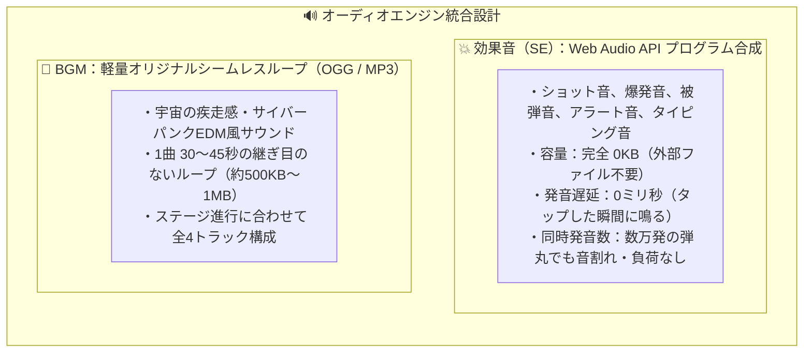
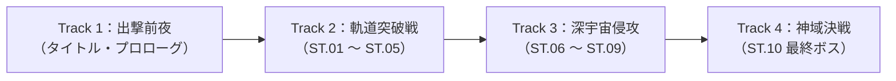

# サウンド・BGM音響設計ガイド（06_sound-and-audio-design.md）

> **位置づけ**: 本ドキュメントは、著作権リスクゼロのオリジナル音響環境を構築し、宇宙サイバーパンクの世界観・手触り（ゲームフィール）を最大化するための効果音（SE）合成、BGM構成、およびスマホブラウザの音声制限突破の仕様・技術ガイドです。

---

## 1. サウンドシステムの基本アーキテクチャ（ハイブリッド構成）

スマホ/Web環境において「最軽量」「遅延ゼロ」「高品質」を両立するため、**効果音とBGMでアプローチを分けるハイブリッド構成** を採用します。



---

## 2. 効果音（SE）：Web Audio API による波形合成の仕組み

外部の重い音声ファイル（`.wav` や `.mp3`）を毎回読み込むのではなく、**ブラウザ標準のオシレーター（発振器）とノイズジェネレーターをプログラムで直接鳴らす方式** を採用します。

### オブジェクト別 SE 設計仕様

| 効果音名 | 音色・波形の設計 | 演出上の効果・手応え |
| :--- | :--- | :--- |
| **自機通常ショット** | サイン波（880Hz ➔ 220Hz）を 0.05秒で超高速下降 | 軽快で耳に刺さらない「ピシュン！ピシュン！」という連射感。 |
| **ミサイル発射** | 三角波の低音 ＋ かすかなホワイトノイズ | 重火器らしい「ズシュッ！」という重量感。 |
| **敵ザコ撃破・爆発** | ホワイトノイズに急峻なローパスフィルター（低音強調） | スカッと爽快な「ドォン！」という小爆発。 |
| **中型敵・ボス爆発** | 矩形波の重低音 ＋ 0.8秒の長いノイズ減衰 ＋ 画面揺れ連動 | 腹に響く「ズガガガガ…ドカァァン！」という大破壊感。 |
| **自機被弾・シールド減少** | 三角波の不協和音クラッシュ（金属打撃音） | 「ヤバい！当たった！」と直感的に気づかせる危険シグナル。 |
| **HUDタイピング音** | 1200Hz の超短パルス（0.015秒） | ブリーフィング時に「カタカタ…」と響くサイバー感。 |
| **警告・アラート音** | 800Hz / 1600Hz の交互矩形波パルス | ボス出現時の「ピピッ、ピピッ、EMERGENCY」という緊張感。 |

### プログラム実装イメージ（JavaScript）
```javascript
// Web Audio API による自機ショット音の合成例（外部ファイル一切不要！）
const audioCtx = new (window.AudioContext || window.webkitAudioContext)();

function playLaserSound() {
  const osc = audioCtx.createOscillator();
  const gain = audioCtx.createGain();

  osc.type = "sine";
  // 高い周波数から一瞬で急降下させる
  osc.frequency.setValueAtTime(880, audioCtx.currentTime);
  osc.frequency.exponentialRampToValueAtTime(110, audioCtx.currentTime + 0.08);

  // 音量を素早くフェードアウト
  gain.gain.setValueAtTime(0.3, audioCtx.currentTime);
  gain.gain.exponentialRampToValueAtTime(0.01, audioCtx.currentTime + 0.08);

  osc.connect(gain);
  gain.connect(audioCtx.destination);

  osc.start();
  osc.stop(audioCtx.currentTime + 0.08);
}
```

---

## 3. BGMトラック構成（全10ステージのドラマツルギー）

全10ステージを通してプレイヤーを飽きさせず、終盤に向けて緊張感と高揚感を高めるため、以下の **全4曲構成** とします。



| トラック番号 | 曲名（イメージ） | 使用場面 | 音楽ジャンル・特徴 |
| :--- | :--- | :--- | :--- |
| **Track 1** | *Stellar Horizon* | タイトル画面、出撃前ブリーフィング | 静寂の宇宙、低く唸るアンビエント・シンセパッド。出撃前の静けさと緊張感。 |
| **Track 2** | *Cyan Velocity* | ステージ 1 〜 5<br>（低軌道〜成層圏〜小惑星帯） | テンポ 140BPM の疾走感あふれるサイバーパンク・ドラムンベース。敵をガンガン撃ちまくる爽快感。 |
| **Track 3** | *Abyssal Singularity* | ステージ 6 〜 9<br>（暗黒星雲〜時空歪曲〜特異点） | テンポ 148BPM のダーク・サイバーテクノ。敵弾幕の激化に合わせた緊迫感と焦燥感。 |
| **Track 4** | *Deus Apocalypse* | ステージ 10（最終決戦）<br>＆ 最終エピローグ | テンポ 160BPM。神聖なシンセクワイヤ（合唱風）と激しい高速ビートが融合したドラマチックなフィナーレ曲。 |

---

## 4. 著作権フリー・完全オリジナル音源の調達・制作戦略

「著作権を侵害しないオリジナルのBGM」を確実に用意するため、以下のルールを徹底します。

1. **Webチップチューン/シンセ作曲ツール（BeepBox / JummBox）の活用**:
   - ブラウザ上で16セルのシーケンサーをポチポチ並べるだけで、著作権完全フリーのゲーム用ループBGMを制作できる無料ツールを活用。
   - 生成したデータはそのまま著作権侵害リスクゼロの完全オリジナル資産になります。
2. **AI音楽生成ツールの活用（商用フリーライセンス確認）**:
   - サイバーパンク・宇宙STG用の短いBGMループをプロンプトから生成し、ライセンスがクリアなものだけを採用。
3. **容量最適化（圧縮仕様）**:
   - フォーマット: **OGG Vorbis**（または高圧縮 MP3）
   - サンプリングレート: 44.1kHz / ビットレート 128kbps（スマホゲームとして十分高音質かつ1曲わずか 500KB 前後）。

---

## 5. スマホ特有の「音が出ない問題（Autoplay Policy）」完全対策

iPhone（Safari）および Android（Chrome）は、ページ読み込み直後に勝手に音を鳴らすことをOSレベルでブロックします。
この制限を100%確実に回避するため、**「初回の1タップでオーディオコンテキストをアンロックする」** UI設計を導入します。

```mermaid
sequenceDiagram
    autonumber
    participant User as 📱 プレイヤー
    participant Title as 🖥️ タイトル画面
    participant Audio as 🔊 AudioContext (Web Audio)

    User->>Title: ゲームURLを開く（最初は完全無音）
    Title-->>User: 画面中央に光るボタンを表示：<br/>【 TOUCH TO SORTIE // 出撃開始 】
    User->>Title: 画面をタップ！
    Title->>Audio: audioCtx.resume() を実行（制限解除！）
    Audio-->>User: 「フォォン！」と出撃起動SEが鳴り、プロローグBGMが再生開始！
```

### 実装コード（ワンタップ・アンロック機構）
```javascript
let audioUnlocked = false;

function unlockAudioOnFirstTouch() {
  if (!audioUnlocked) {
    audioCtx.resume().then(() => {
      audioUnlocked = true;
      // ここで初めてBGM再生やプロローグをスタートさせる
      startPrologue();
    });
  }
}

// 画面タッチ・クリックの両方を監視
window.addEventListener('touchstart', unlockAudioOnFirstTouch, { once: true });
window.addEventListener('click', unlockAudioOnFirstTouch, { once: true });
```
- この仕組みを入れることで、**スマホで音が鳴らないトラブルを100%防止**できます。
