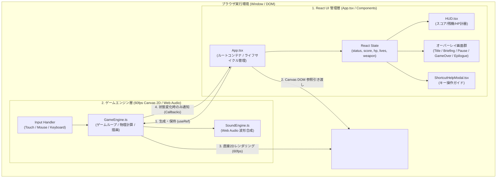
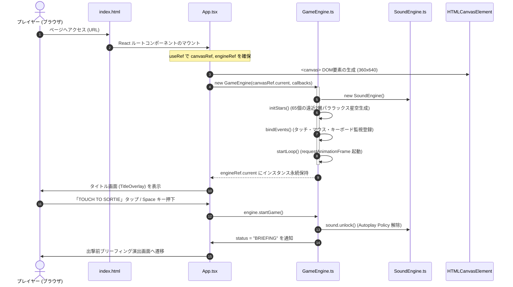
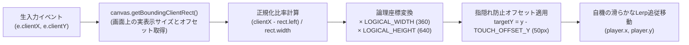
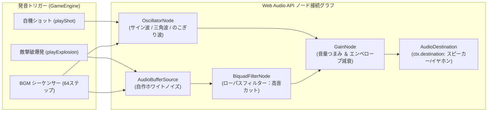
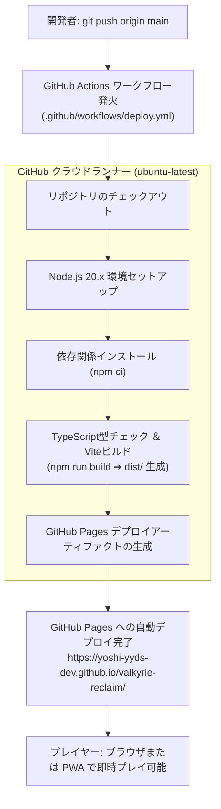

# 『VALKYRIE RECLAIM』技術仕様書・システムアーキテクチャ解説書 (Technical Architecture & Flow)

本書は、本格2D縦スクロールシューティングゲーム『VALKYRIE RECLAIM (VOID VANGUARD)』の全体的なシステム構造、採用技術スタック・ライブラリ・ツール、および起動から毎フレームの描画・音響合成・CI/CDデプロイに至る「全体技術フロー」を、開発者・エンジニア向けに体系的かつ詳細に解説した技術仕様書です。

---

## 1. エグゼクティブサマリー ＆ コア設計思想

本作は、**「Webブラウザ上で動作するネイティブ級のハイパフォーマンスSTG」** を目指し、以下の3大設計思想に基づいて設計されています。

1. **React（UI層）と HTML5 Canvas 2D（コア層）のハイブリッド分離アーキテクチャ**:
   - 画面演出やボタン、HUDなどの宣言的UI管理には **React + Tailwind CSS** を採用。
   - 毎秒数百発の弾幕や敵機、パーティクルが高速移動する戦闘計算には **純粋な TypeScript + HTML5 Canvas 2D API** を採用。
   - 仮想DOMの再計算負荷とガベージコレクションを徹底排除し、モバイル端末でも安定した 60fps を維持します。
2. **ゼロ・外部アセット（Zero-Asset Download）構成**:
   - 音声ファイル（MP3/WAV）を一切持たず、**Web Audio API による波形合成** で全SEおよび64ステップBGMをコード上でリアルタイム生成。
   - 機体グラフィックは Canvas 2D パス描画、UIアイコンはインライン SVG（Lucide）で描画。
   - これにより、初回ロード時間は **0.1秒未満**、通信量数KB、完全オフライン対応を実現。
3. **論理仮想解像度（360 × 640）による完全レスポンシブ保証**:
   - どんな画面サイズ（PC、iPad、スマホ）でも「横360 × 縦640（9:16）」の仮想空間内で同一の物理挙動・当たり判定を保証。

---

## 2. 採用技術スタック・ライブラリ・ツール一覧

| レイヤー / 分野 | 採用技術・ツール | バージョン | 選定理由・システムにおける役割 |
|---|---|:---:|---|
| **コア言語** | **TypeScript** | `^5.x` | 静的型付けによるタイプセーフなデータモデル設計。タイプミスや実行時例外をコンパイル前に完全遮断。 |
| **フロントエンドUI** | **React** | `^18.x` | タイトル画面、ブリーフィング、ポーズ、ゲームオーバー画面、上部HUDのライフサイクルおよび状態管理。 |
| **ビルドツール** | **Vite** | `^8.3` | 超高速な開発用HMR（Hot Module Replacement）および Rollup による極小プロダクションバンドル生成。 |
| **スタイリング** | **Tailwind CSS** | `^3.x` | レトロサイバーパンク基調のカラーパレット定義、9:16比率固定レスポンシブコンテナ計算。 |
| **アイコン** | **Lucide React** | `^0.4x` | 一時停止、音声ミュート、再挑戦、ホームボタンなどの高精細・軽量ベクターアイコン描画。 |
| **描画エンジン** | **HTML5 Canvas 2D Context** | Web標準 | ブラウザ標準のハードウェアアクセラレーションを活用した 60fps 超高速ゲームレンダリング。 |
| **音響エンジン** | **Web Audio API** | Web標準 | Oscillator（発振器）、GainNode、BiquadFilter、AudioBuffer によるリアルタイム波形合成（SE & BGM）。 |
| **アプリ化 (PWA)** | **Service Worker / Manifest** | Web標準 | ホーム画面追加（スタンドアロン全画面起動）、アセットキャッシュ、オフラインプレイ完全対応。 |
| **CI/CD** | **GitHub Actions** | - | `main` ブランチへのプッシュをトリガーとした自動テスト・ビルド・デプロイパイプライン。 |
| **ホスティング** | **GitHub Pages** | - | 高速・無料・HTTPS暗号化されたグローバルCDN配信環境。 |

---

## 3. システムアーキテクチャ・構造設計

### 3.1 レイヤー分離設計（UI層 と ゲームコア層）

アプリケーションは、描画と責務の観点から明確に 2 つの層に分離され、`useRef` とコールバック関数を介して疎結合に連携しています。



#### なぜこの分離が必要なのか？
- **描画ボトルネックの回避**: React の `useState` で毎秒数百個の弾丸座標（x, y）を更新すると、React が毎秒数百回も仮想DOMの差分比較（Reconciliation）を行い、モバイル端末では重度のフレーム落ち（カクつき）が発生します。
- **解決策**: 移動・当たり判定はすべて `GameEngine` 内の純粋な TypeScript オブジェクト配列で高速演算し、React へは「スコアが増えた」「HPが減った」「状態がゲームオーバーになった」という **画面全体のUI更新が必要な瞬間だけ** コールバックで通知します。

---

### 3.2 ディレクトリ構成とモジュール責務一覧

```text
app/src/
├── App.tsx                    # アプリケーション全体の司令塔。Canvas管理とオーバーレイ画面の切り替え
├── main.tsx                   # React ルートエントリーポイント（ReactDOM.createRoot）
├── index.css                  # Tailwind CSS ディレクティブおよび基本スタイル
├── game/                      # 🚀 60fps ゲームコアエンジン群（React非依存）
│   ├── types.ts               # ゲーム内エンティティ・状態・解像度定数の型定義（契約書）
│   ├── GameEngine.ts          # ゲームループ、自機・敵・弾幕・当たり判定・ステージ進行・描画
│   └── SoundEngine.ts         # Web Audio API によるリアルタイムSE合成および64ステップBGM演奏
├── components/                # 🎨 React 宣言的UIコンポーネント群
│   ├── HUD.tsx                # 上部固定計器パネル（スコア、HPセグメント、自機3機SVG残機、武器Lv）
│   ├── TitleOverlay.tsx       # タイトル画面（難易度選択、出撃ボタン、PWAインストールボタン）
│   ├── BriefingOverlay.tsx    # 出撃前プロローグ演出（世界観シナリオ、タイプライター、即出撃）
│   ├── PauseOverlay.tsx       # ポーズ画面（再開、リトライ、ミュート、タイトル復帰）
│   ├── GameOverOverlay.tsx    # ゲームオーバー専用画面（コンティニュー不可、戦績提示、再挑戦）
│   ├── EpilogueOverlay.tsx    # 最終エピローグ画面（全10ステージクリア凱旋、スコアロールアップ、ランク）
│   ├── DevTestPanel.tsx       # 開発用検証パネル（ステージ選択、ボス直行、武器Lv選択：?dev=1で保護）
│   └── ShortcutHelpModal.tsx  # キーボードショートカット一覧モーダル（[H] / [?] キーでトグル）
└── assets/                    # 静的背景アート（プロローグ・エピローグ用背景画像）
```

---

## 4. 全体的な技術フロー（Technical Flow）

### 4.1 アプリケーション起動・初期化フロー（Lifecycle Flow）

ブラウザがページを読み込んでから、ゲームループが開始されるまでの一連の流れです。



---

### 4.2 メインゲームループ処理フロー（Frame Cycle Flow）

`startLoop()` によって、ブラウザのリフレッシュレート（60Hz〜144Hz）に合わせて毎フレーム実行される内部処理フローです。1フレームあたり約 16.6ms の制限時間内で以下のステップが順次実行されます。

```mermaid
flowchart TD
    START["ブラウザ requestAnimationFrame(loop) 発火"] --> TS["1. タイムスタンプ取得 ＆ dt（デルタタイム）計算\ndt = Math.min((now - lastTime)/1000, 0.05)"]
    
    TS --> UPDATE["2. 物理演算・ロジック更新：update(dt)"]
    
    subgraph UPDATE_PHASE["update(dt) の詳細処理"]
        STARS["星空パララックススクロール (背景)"]
        INPUT_PROC["プレイヤー入力反映 (タッチ追従 / キーボード移動 / オート連射)"]
        BULLETS["自機弾の移動 ＆ 最寄敵ホーミング旋回計算 (atan2)"]
        STAGE_TIME["道中スクロール時間計測 ＆ 中型ガンシップ/ボス出現判定"]
        ENEMIES["敵AI移動 (直線/突進/ホバリング) ＆ 敵弾発射"]
        COLLISION["衝突判定 (三平方の定理 Math.hypot による円判定)"]
        EXPLOSION["爆発パーティクル更新 ＆ アイテム浮遊移動"]
        BOSS_ACT["ボス特殊ギミック更新 (うねり/シールド/自己再生/ワープ/極太ビーム/重力場)"]
    end
    
    UPDATE --> UPDATE_PHASE
    UPDATE_PHASE --> RENDER["3. Canvas 2D 画面描画：render()"]
    
    subgraph RENDER_PHASE["render() の詳細処理"]
        CTX_SAVE["ctx.save() で初期コンテキスト保存"]
        SHAKE["カメラシェイク座標平行移動 (translate)"]
        CLEAR["宇宙空間背景クリア (#070913)"]
        DRAW_STARS["星空の描画"]
        DRAW_BULLETS["自機弾のネオン描画 (回転角 rotate)"]
        DRAW_ITEMS["アイテムカプセル描画"]
        DRAW_ENEMIES["4タイプの敵機ベクター描画"]
        DRAW_BOSS["ボス背面ギミック(予告線/ビーム/重力リング) ＋ ボス本体装甲"]
        DRAW_PLAYER["自機本体 ＋ 噴射スラスター炎アニメーション"]
        DRAW_PARTS["爆発火花パーティクル描画"]
        CTX_RESTORE["ctx.restore() でコンテキストを完全復元"]
    end
    
    RENDER --> RENDER_PHASE
    RENDER_PHASE --> CB["4. 状態変化があった場合のみ React コールバック通知\n(onScoreChange, onHpChange, onStatusChange)"]
    CB --> NEXT_FRAME["次の requestAnimationFrame を予約"]
```



---

### 4.3 ユーザー入力・座標変換パイプライン（Input Pipeline）

プレイヤーの指やマウス操作を、画面サイズに依存しないゲーム内座標へ正しく変換するフローです。



---

### 4.4 音響合成パイプライン（Web Audio Synthesis Flow）

外部ファイル（MP3/WAV）を使わず、ブラウザ内部のデジタルシンセサイザーで音を鳴らす仕組みです。



- **ショット音の数式**: 0.06秒間で周波数を 880Hz（高いラ）から 220Hz（低いラ）へ指数関数的に急降下（`exponentialRampToValueAtTime`）させることで、澄んだレーザー音を表現。
- **爆発音の数式**: `-1.0 〜 +1.0` の乱数を敷き詰めたホワイトノイズに、カットオフ周波数 900Hz ➔ 100Hz のローパスフィルターを通すことで、地響きのような重低音を生成。
- **BGMシーケンサー**: 120BPM・16分音符間隔のタイマーで、ドラム（キック・スネア・ハイハット）、ベースライン、リードメロディ、シンセパッドの全4トラックをリアルタイム合成してコード進行を演奏。

---

### 4.5 CI/CD ＆ デプロイメントパイプライン（Deployment Pipeline）

コード変更を GitHub にプッシュした瞬間から、全世界のプレイヤーへ届くまでの自動化フローです。



---

## 5. 技術者が知っておくべきコアアルゴリズムと数学的背景

### 5.1 複合円当たり判定（マルチサークル・コリジョン）
- **課題**: 自機を1つの大きな円で囲むと、「機体の斜め前の空間」に弾が当たっても被弾してしまい、不条理感（理不尽さ）を生む。
- **実装**:
  ```typescript
  // 機首・胴体中央・左翼・右翼の4つのパーツ円でシルエットを近似
  hitboxes: [
    { offsetX: 0, offsetY: -13, radius: 5 },  // 機首先端
    { offsetX: 0, offsetY: 3, radius: 7 },    // 胴体
    { offsetX: -12, offsetY: 10, radius: 6 }, // 左翼
    { offsetX: 12, offsetY: 10, radius: 6 },  // 右翼
  ]
  ```
- **判定式**: 三平方の定理（ピタゴラスの定理）
  $$\text{距離}^2 = (x_1 - x_2)^2 + (y_1 - y_2)^2 < (r_1 + r_2)^2$$
  ゲームプログラミングの定石として、CPU負荷の高い平方根（`Math.sqrt`）を避け、半径の和の2乗と比較することで高速演算を実現。

### 5.2 ホーミングレーザーの角度追尾と最短旋回
- **課題**: 単純に目標角度へ向けると、180度（$\pi$）境界で逆回りに大回りしてしまう。
- **実装**:
  ```typescript
  let diff = targetAngle - currentAngle;
  // 角度差を -PI 〜 +PI に正規化
  while (diff > Math.PI) diff -= Math.PI * 2;
  while (diff < -Math.PI) diff += Math.PI * 2;
  // 最大旋回レートで徐々に目標角度へ近づける
  const turnRate = 8.5 * dt;
  const nextAngle = currentAngle + Math.max(-turnRate, Math.min(turnRate, diff));
  ```

### 5.3 スコアロールアップ演出の 3次減速イージング（Cubic Ease-Out）
- **数式**:
  $$\text{eased}(p) = 1 - (1 - p)^3 \quad (0 \le p \le 1)$$
- **効果**: 開始直後は一気に高速で数字が上がり、目標値に近づくにつれて滑らかに減速してピタッと止まる。プレイヤーに「大量得点を獲得した快感」を与える定番のゲームUI演出。

### 5.4 イベントバブリング遮断によるモーダル保護
- **課題**: モーダルの背景（黒半透明）をクリックした時にモーダルを閉じる処理（`onClick={onClose}`）を入れると、モーダル内のボタンや文字をクリックした際にも親へとイベントが伝播（バブリング）して勝手に閉じてしまう。
- **解決策**: モーダル本体コンテナに `onClick={(e) => e.stopPropagation()}` を記述してイベントの伝播を遮断。

---

## 6. まとめ ＆ 今後の拡張性（Scalability）

本作のアーキテクチャは、**「ゲーム本体（純粋ロジック・Canvas）」と「UI・画面遷移（React）」が完全に分離されている** ため、以下の拡張が極めて容易に行えます。

1. **マルチプラットフォーム展開**:
   - `Capacitor` や `Tauri` を組み合わせることで、同一のソースコードのまま iOS (App Store)、Android (Google Play)、Steam (PCデスクトップアプリ) へのネイティブアプリ化が可能。
2. **オンラインリーダーボード連携**:
   - `Firebase Firestore` や `Supabase` と接続し、ハイスコアやクリアタイムのグローバルランキング機能を React レイヤーへ数行で統合可能。
3. **新規ステージ・敵機・ボスの追加**:
   - `types.ts` と `GameEngine.ts` の定義テーブルに配列要素を追加するだけで、11面以降のステージや新たな弾幕ギミックを安全に拡張可能。
