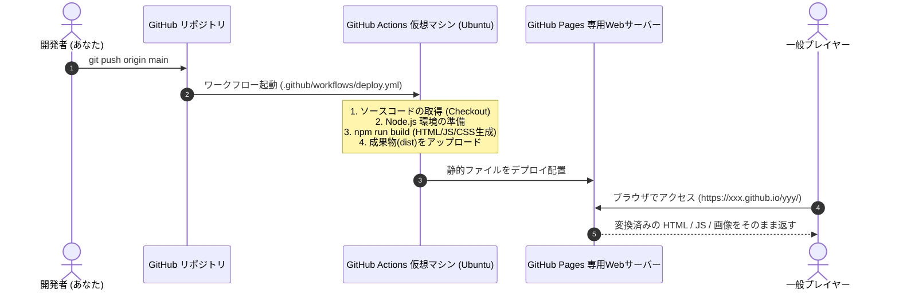
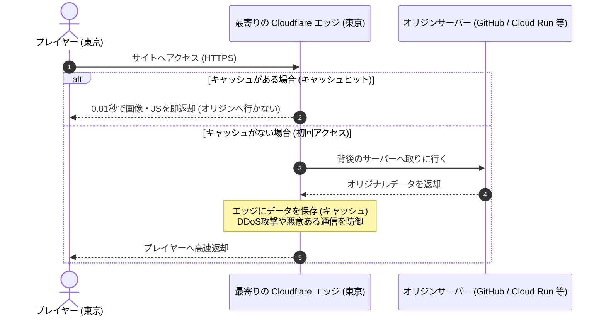
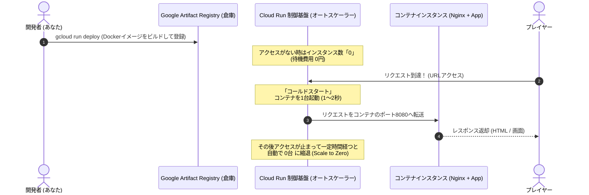
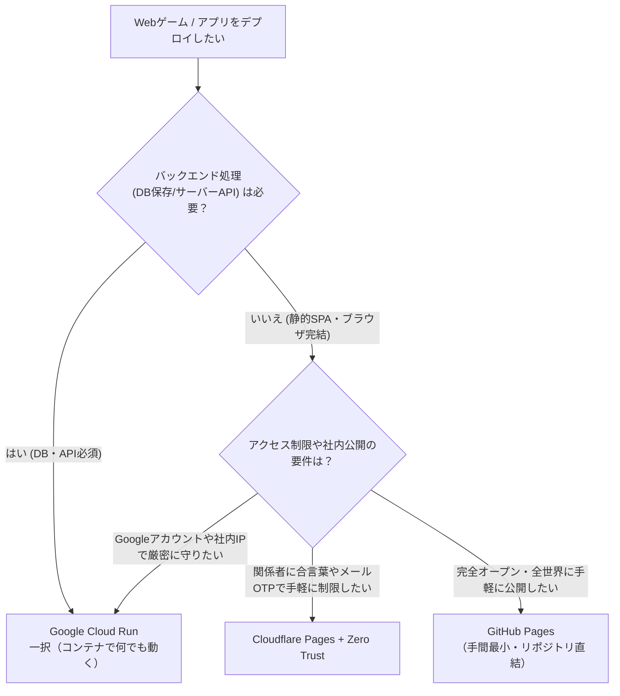

# 08. デプロイ基盤の仕組み徹底解説（GitHub Pages / Cloudflare / Cloud Run）

本書は、WebアプリケーションやHTML5/PWAゲームをインターネット上に公開する代表的な3大プラットフォーム――**「GitHub Pages」「Cloudflare」「Google Cloud Run」** について、内部でどのような処理や通信が行われているのか、初心者にも直感的に理解できるよう仕組みを図解とともに体系化した技術ドキュメントです。

---

## 1. 3大プラットフォームの全体比較サマリー

| 項目 | ① GitHub Pages (Actions) | ② Cloudflare (Pages / CDN) | ③ Google Cloud Run |
| :--- | :--- | :--- | :--- |
| **主な役割** | **リポジトリ直結の静的ホスティング** | **地球規模のエッジCDN ＆ 静的/エッジ実行** | **コンテナ型サーバーレス実行基盤** |
| **動く中身** | 静的ファイル（HTML/CSS/JS/画像） | エッジキャッシュ ＋ 静的ファイル ＋ Worker関数 | Dockerコンテナ（Linux + サーバープログラム） |
| **バックエンド処理** | 不可（ブラウザ完結のみ） | 軽量処理のみ（KV / D1 / Workers） | **完全自由（Python / Node.js / Go / DB接続）** |
| **ユーザー制限** | リポジトリ公開範囲（Privateは有料Enterprise） | **Cloudflare Zero Trust（メールワンタイムパス等）** | **IAM認証 / IAP（Googleアカウント認証） / Basic認証** |
| **料金目安** | 完全無料 | 無料枠が極めて広大（実質0円運用） | 無料枠大（月200万リクエストまで実質0円） |
| **得意な用途** | オープンソース、ポートフォリオ、個人開発 | 世界中からの超高速アクセス、強固なアクセス制限 | **社内専用システム、認証必須アプリ、API/DB連携** |

---

## 2. GitHub Pages の仕組み（GitHub Actions で何が起きているか？）

GitHub Pages は、ソースコードを `git push` するだけで自動的にビルドされ、Webサイトとして公開される仕組みです。
この裏側では **GitHub Actions** という自動化ロボット（CI/CD）が動いています。

### 2.1 全体フロー図

### 2.2 内部で行われている具体的ステップ
1. **コミットの検知**:
   - `main` ブランチにコミットが届くと、GitHub 内部の監視システムが `.github/workflows/` にある定義ファイルを検知します。
2. **クラウド仮想マシンの自動立ち上げ**:
   - GitHub が管理するクラウド上に、一時的な Linux 仮想マシン（Runner）が1台立ち上がります。
3. **ビルド処理の実行**:
   - `git checkout` で最新コードをダウンロードし、`npm install` ➔ `npm run build` を実行します。
   - TypeScript が純粋な JavaScript に変換され、画像や CSS が `dist/` フォルダへ出力されます。
4. **Pages サーバーへの成果物配置**:
   - `dist/` フォルダの中身だけが GitHub Pages 専用のファイル保管庫（CDN配信サーバー）に転送されます。
5. **仮想マシンの破棄**:
   - ビルドが終わると一時仮想マシンは消去され、あとは保管庫に置かれた静的ファイルが全世界のプレイヤーに配信されます。

---

## 3. Cloudflare の仕組み（エッジネットワークとプロキシ）

Cloudflare（クラウドフレア）は、世界300都市以上に広がる「巨大なキャッシュサーバー網（エッジネットワーク）」を持つインフラサービスです。
主に **Cloudflare Pages（静的配信）** や **Cloudflare DNS/Proxy（Webの盾・高速化）** として利用されます。

### 3.1 全体フロー図

### 3.2 なぜ Cloudflare は速く、安全なのか？
1. **エッジ（最寄り地点）での即答**:
   - サーバーがアメリカや遠くにあっても、プレイヤーから一番近いデータセンター（東京や大阪のエッジ）がデータを代理返却するため、極めて高速に画面が開きます。
2. **Webの「盾」としての防御**:
   - すべての通信を Cloudflare が中継（プロキシ）するため、裏側の本当のサーバーのIPアドレスが隠蔽され、DDoS攻撃や不正アクセスを水際でブロックします。
3. **Cloudflare Zero Trust による利用者制限**:
   - サイトの前に「メールアドレス確認（ワンタイムピン送信）」や「Google / GitHub ログイン」の認証画面をノーコードで挟み、特定の関係者だけにアクセスを限定できます。

---

## 4. Google Cloud Run の仕組み（コンテナ型サーバーレス）

Cloud Run は、Google Cloud が提供する **「コンテナを自動で動かしてくれるサーバーレス環境」** です。
静的ファイルだけでなく、**「サーバーサイドのプログラム（Python, Node.js, Go 等）」や「認証・データベース通信」** まで何でも動かせるのが最大の特徴です。

### 4.1 全体フロー図

### 4.2 内部で行われている具体的ステップ
1. **コンテナ化（Docker）**:
   - アプリ（HTML/JS）と超軽量Webサーバー（nginx）を1つの「Dockerコンテナ」という箱にパッケージ化します。
2. **待機時コスト 0円（Scale to Zero）**:
   - 誰もアクセスしていない間、Cloud Run はサーバーを停止させておきます。そのため、**アクセスがない時間の電気代・サーバー代は 1円も発生しません**。
3. **リクエスト駆動の高速起動（オートスケール）**:
   - ユーザーがアクセスした瞬間にコンテナがポンと立ち上がり、リクエストを処理します。同時に1,000人からアクセスがあれば、自動的に10台、20台とコンテナが増殖して負荷を分散します。
4. **Googleの強固なセキュリティ（IAM / IAP）**:
   - Googleの社内インフラと同じ仕組みで守られており、**「指定した Google アカウントのみアクセス許可」「社内ドメイン（@yy-ds.net）のみ許可」** といった高度なアクセス制御が設定画面から簡単に適用できます。

---

## 5. ユースケース別：どれを選ぶべきか？

1. **GitHub Pages が最適なケース**:
   - 完全公開の個人開発、ポートフォリオ、GitHub リポジトリから一番手軽に全世界へ届けたいとき。
2. **Cloudflare Pages が最適なケース**:
   - 世界中から超高速にアクセスさせたいとき。または、関係者だけにメールピン認証でプレビューさせたいとき。
3. **Google Cloud Run が最適なケース**:
   - **自社の Google アカウント（`@yy-ds.net`）限定で安全に公開したいとき**。
   - 将来的に「ユーザーのオンラインスコア・ランキング」を Google Cloud のデータベース（Firestore / Cloud SQL）に保存したいとき。
