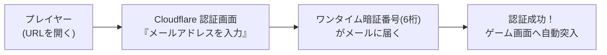

# Webゲーム公開実践ガイド：GitHub Pages ＆ Cloudflare Pages 完全攻略マニュアル

> **文書の位置づけ**: 本書は、Vite + React + TypeScript で開発した PWA 対応 Web ゲーム（`VALKYRIE RECLAIM`）を、世界中のプレイヤーに届けるための **「GitHub Pages」** および **「Cloudflare Pages」** の両方で並行公開するための実践手順書です。今後の別プロジェクトでも再利用できる永久保存版ナレッジとして記録します。

---

## 1. 2大ホスティングの特徴・使い分け比較

| 項目 | GitHub Pages | Cloudflare Pages |
| :--- | :--- | :--- |
| **位置づけ** | エンジニアの登竜門。GitHub内で完結する標準公開機能。 | 世界最強インフラ。超高速CDN・帯域無制限・高度なセキュリティ。 |
| **費用** | 完全無料（0円） | 完全無料（0円・クレジットカード不要） |
| **ソースコードの秘匿** | 無料枠は **Public（全体公開）必須** | **Private（非公開リポジトリ）のまま公開可能！** |
| **閲覧者（プレイヤー）の制限** | 無料枠では不可（URLを知れば誰でも閲覧可能） | **Cloudflare Access により、指定した人のみPIN認証で閲覧可能！** |
| **転送量（通信量）制限** | 月間 100GB まで（ソフトリミット） | **完全無制限** |
| **自動デプロイ** | GitHub Actions で自動化 | GitHub連携により `git push` で全自動ビルド |

---

## 2. 【共通準備】マルチデプロイ対応のプロジェクト設定

どちらのホスティングでも全く同じコードで動かすための最重要ポイントは **「相対パス（Relative Path）」** です。

### 2.1 `vite.config.ts` の `base: './'` 設定
- **理由**: GitHub Pages はサブディレクトリ（`https://<ユーザー名>.github.io/<リポジトリ名>/`）で動き、Cloudflare Pages はルート直下（`https://<プロジェクト名>.pages.dev/`）で動きます。
- `base: './'` を指定しておくことで、どちらの環境にデプロイしても画像・音声・スクリプトのリンク切れが絶対に起きなくなります。

```typescript
// app/vite.config.ts
import react from '@vitejs/plugin-react'
import { defineConfig } from 'vite'

export default defineConfig({
  base: './', // 必須設定：相対パスでビルド
  plugins: [react()],
})
```

---

## 3. 【実践 A】GitHub Pages による公開手順

### 概要
GitHub リポジトリ（Public）にコードをプッシュし、GitHub サーバー上で自動ビルドして公開します。

### ステップ 1：GitHub 上でリポジトリを作成
1. ブラウザで [GitHub](https://github.com/)（組織または個人アカウント）にログイン。
2. 右上の「＋」→ **New repository** を開く。
3. 設定：
   - **Repository name**: `valkyrie-reclaim`
   - **Public**（無料の GitHub Pages は Public 必須）
   - ※「Add a README file」などの初期化チェックは **すべて外して空のリポジトリ** にする。
4. 「Create repository」をクリック。

### ステップ 2：GitHub Actions 自動デプロイ定義の配置
プロジェクト内に以下のワークフローファイル（`.github/workflows/deploy-shooting-game.yml`）を配置します。

```yaml
name: Deploy to GitHub Pages

on:
  push:
    branches: [main]
  workflow_dispatch:

permissions:
  contents: read
  pages: write
  id-token: write

concurrency:
  group: "pages"
  cancel-in-progress: false

jobs:
  deploy:
    environment:
      name: github-pages
      url: ${{ steps.deployment.outputs.page_url }}
    runs-on: ubuntu-latest
    steps:
      - name: Checkout
        uses: actions/checkout@v4

      - name: Setup Node
        uses: actions/setup-node@v4
        with:
          node-version: 20

      - name: Install dependencies
        run: |
          cd games/00001_shooting-game/app
          npm install

      - name: Build
        run: |
          cd games/00001_shooting-game/app
          npm run build

      - name: Setup Pages
        uses: actions/configure-pages@v5

      - name: Upload artifact
        uses: actions/upload-pages-artifact@v3
        with:
          path: games/00001_shooting-game/app/dist

      - name: Deploy to GitHub Pages
        id: deployment
        uses: actions/deploy-pages@v4
```

### ステップ 3：GitHub リポジトリ設定で Actions を有効化
1. リポジトリの **Settings** タブを開く。
2. 左メニューの **Pages** をクリック。
3. **Build and deployment** の **Source** を **`GitHub Actions`** に切り替える。

### ステップ 4：プッシュして公開
コードをコミットして `git push origin main` を行うと、**Actions** タブで自動的にビルドが走り、数分で以下のURLで公開されます。
- **公開URL**: `https://<GitHubユーザー名>.github.io/valkyrie-reclaim/`

---

## 4. 【実践 B】Cloudflare Pages による公開手順

### 概要
GitHub リポジトリ（**Private でも OK**）と Cloudflare を接続し、世界最高速の CDN で配信します。特定の人だけに遊ばせるアクセス制限もここで設定できます。

### ステップ 1：Cloudflare アカウントの作成（無料）
1. [Cloudflare 公式サイト](https://dash.cloudflare.com/sign-up) を開き、メールアドレスとパスワードだけで無料登録（クレジットカード不要）。

### ステップ 2：Pages プロジェクトの作成と GitHub 連携
1. Cloudflare ダッシュボードの左メニューから **Workers & Pages** をクリック。
2. **Create application** ➔ **Pages** タブ ➔ **Connect to Git** をクリック。
3. **GitHub アカウントを連携** し、先ほど作ったリポジトリ（`valkyrie-reclaim`）を選択して「Begin setup」をクリック。

### ステップ 3：ビルド設定の入力（Vite 専用設定）
設定画面で以下のように入力します：
- **Project name**: `valkyrie-reclaim`（そのまま）
- **Production branch**: `main`
- **Framework preset**: `Vite` を選択
- **Root directory (重要)**: `games/00001_shooting-game/app`
- **Build command**: `npm run build`
- **Build output directory**: `dist`
- **Environment variables（環境変数）**:
  - 変数名: `NODE_VERSION` / 値: `20`

### ステップ 4：保存とデプロイ（Save and Deploy）
- 「**Save and Deploy**」ボタンを押すと、Cloudflare が自動でソースコードを取得してビルドを開始します（約1分で完了）。
- **公開URL**: `https://valkyrie-reclaim.pages.dev` が即座に発行されます！
- 以降は GitHub に `git push` するたびに、自動的に Cloudflare 側も最新版に更新されます。

---

## 5. 【超重要】特定の人だけに遊ばせる「アクセス制限（保護）」の設定手順

Cloudflare Pages の真骨頂である **「指定したメールアドレスの人だけに暗証番号（PIN）を送る機能」** を設定する手順です（**完全無料・5分で完了**）。



1. Cloudflare ダッシュボードで作成した Pages プロジェクト（`valkyrie-reclaim`）を開く。
2. 上部タブの **Settings** ➔ **Access Policy（または Zero Trust）** を開く。
3. **Enable Access** をクリック（初回のみ Zero Trust チーム名を決める・無料）。
4. **Add an application** で以下を設定：
   - **Application name**: `Valkyrie Reclaim Playtest`
   - **Policy name**: `Allowed Testers`
   - **Action**: `Allow`
   - **Include（許可対象）**:
     - Selector: **Emails**
     - Value: プレイを許可したい相手のメールアドレス（自分のアドレスや友人のアドレスなど、複数指定可能）
5. 保存すると、以降はそのURL（`https://valkyrie-reclaim.pages.dev`）にアクセスした際、**登録されたメールアドレス宛に届く6桁のPINコードを入力した人だけ** がゲーム画面へ入れるようになります！
   - ※相手は GitHub アカウントもパスワードも不要で、メールの数字を入れるだけなので非常に快適です。

---

## 6. まとめ：2つの公開方式の活用戦略

- **GitHub Pages**:
  - 全世界への公開用、ポートフォリオ用、ソースコードと公開サイトをセットで管理するエンジニア標準の使い方。
- **Cloudflare Pages**:
  - 本番運用用、仲間内やテスター限定の先行プレイテスト用、Privateリポジトリを保ったまま高速配信したい時の最高峰の選択肢。

この2つをマスターすることで、今後のどんなWebアプリ・ゲーム開発でも自由自在にリリースできるようになります。
