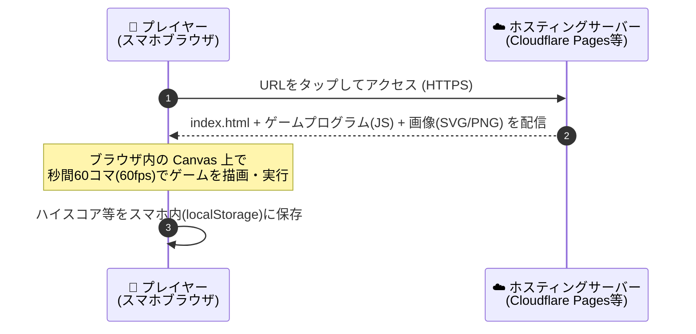
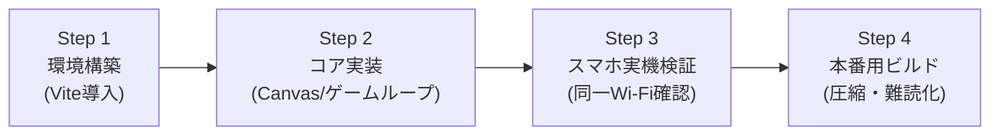

# パターン1：Webアプリ（ブラウザ直接プレイ型）の開発・リリース完全ガイド

> **位置づけ**: 3つの届け方のすべての土台となる基本形態です。スマホのブラウザ（iOS Safari / Android Chrome 等）でURLを開くだけで、インストール不要で即座に遊べるゲームを作ります。

---

## 1. 概要と仕組み（アーキテクチャ）

Webアプリ型のゲームは、インターネット上のサーバー（ホスティング環境）に置かれた **「HTML / CSS / JavaScript / 画像・音声ファイル」** を、プレイヤーのスマホブラウザがその場でダウンロードして実行する仕組みです。



### 専門用語の定義
- **HTML5 Canvas（キャンバス）**:
  - Webページの中に用意する「プログラムでお絵描きができる透明な画用紙」です。シューティングゲームでは、1秒間に60回（60fps）この画用紙を書き換えることで、自機や大量の弾幕を滑らかに動かします。
- **静的ホスティング（Static Hosting）**:
  - 複雑な裏側（データベース等）を持たず、ビルドしたHTMLやJSファイルをそのまま高速に配信するサーバーの仕組みです。個人開発なら**完全無料**かつ世界最高水準の速度・セキュリティで公開できます。
- **バンドラー（Vite 等）**:
  - 開発中はファイルを分割して書きやすくし、公開（リリース）時には1〜数個の軽量なファイルに圧縮・結合してくれる開発ツールです。

---

## 2. 採用する技術スタックの選択肢

Webアプリとして2Dシューティングを作る場合、主に以下の3つの選択肢があります。

| 構成パターン | 主な使用技術 | 特徴・向いているケース | 学習効果・難易度 |
| :--- | :--- | :--- | :--- |
| **① 標準 Canvas API + Vite**<br>（★最初の1作目に推奨） | HTML5 Canvas + TypeScript (または JS) + Vite | ゲームエンジンという「ブラックボックス」を使わず、ゲームループ・移動計算・当たり判定の基礎を1から直接理解できる。今回のように **SVG素材（Stitch）** を扱うのにも非常に柔軟。 | ★★☆（基礎が最も身につく） |
| **② Web 2Dゲームエンジン** | **Phaser 3** または **PixiJS** + TypeScript | スプライト管理、物理演算、シーン遷移、パーティクル演出などの機能が最初から揃っている。本格的なエフェクトを素早く量産したい場合に有利。 | ★★☆（エンジンの作法を学ぶ） |
| **③ ハイブリッド構成**<br>（UIをReact、ゲーム画面をCanvas） | React + Tailwind CSS（メニュー・図鑑画面） + Canvas（戦闘画面） | Stitchで作ったHTML/Tailwind製の豪華な「機体ドック」「ボス台帳」をそのままメニュー画面として活かし、出撃ボタンを押したらCanvasの戦闘画面に切り替える構成。 | ★★★（Web開発＋ゲーム開発の両方が身につく） |

---

## 3. 開発の進め方（ステップ・バイ・ステップ）



### Step 1: プロジェクトの初期化（開発環境づくり）
PC上で Node.js とビルドツール **Vite（ヴィート）** を使ってプロジェクトを作成します。
- コマンド1つでローカル開発サーバーが立ち上がり、コードを書き換えた瞬間にブラウザ画面が自動更新（ホットリロード）されます。

### Step 2: スマホ向けUI・タッチ操作・ゲームループの実装
PCでコードを書きながら、スマホ特有の挙動を作り込みます。
1. **タッチ追従移動**: スマホ画面を指でなぞった（スワイプした）移動量に合わせて自機を動かす処理（指で自機が隠れないよう、指の位置より少し上に自機を表示する「オフセット調整」を入れるのがスマホSTGの定石です）。
2. **誤動作防止のCSS設定**:
   - スワイプ中に画面全体が上下に引っ張られてリロード（プル・トゥ・リフレッシュ）されたり、テキスト選択や拡大縮小が起きないよう、`touch-action: none;` や `overscroll-behavior: none;` を設定します。
3. **ブラウザの音声再生制限（Autoplay Policy）への対応**:
   - スマホブラウザは**「ユーザーが画面を1回以上タップした後でないとBGMや効果音を鳴らせない」**という強い制限があります。そのため、「TITLE画面で『TAP TO START』を押した瞬間にオーディオエンジン（Web Audio API）を初期化する」という設計にします。

### Step 3: 手元のスマホ実機でのテストプレイ
公開前に、自宅のWi-Fiを使って自分のスマホで直接触って確認します。
- Viteを `vite --host` オプションで起動すると、ローカルIPアドレス（例: `http://192.168.1.10:5173`）が発行されます。
- 同じWi-Fiに繋いだスマホでそのURLを開けば、PCで書き換えたコードを手元のスマホでリアルタイムにテストプレイできます。

### Step 4: 本番用ビルド（パッケージング）
開発が一通りできたら、`npm run build` を実行します。
- これにより、`dist/` というフォルダの中に、余分な空白が削られ（Minify）、変数名が短縮されて読みづらく加工（簡易難読化）された公開用ファイル一式が出力されます。

---

## 4. リリースの進め方（世界に公開する手順）

Webアプリのリリースは、3パターンの中で**圧倒的に簡単かつ無料**です。

```mermaid
flowchart LR
    A["💻 ローカルPC<br/>(コード完成)"] -->|git push| B["🐙 GitHub<br/>(非公開リポジトリ可)"]
    B -->|自動検知・自動ビルド<br/>(約30秒)| C["☁️ Cloudflare Pages / Vercel<br/>(無料・自動HTTPS)"]
    C -->|URL / QRコード発行| D["📱 プレイヤーがアクセス！"]
```

### おすすめの公開先（ホスティングサービス）

| サービス名 | 費用 | 特徴 |
| :--- | :--- | :--- |
| **Cloudflare Pages**（★最推奨） | **完全無料**（帯域幅無制限） | 世界中のサーバー（CDN）から爆速で配信され、どれだけ多くの人が遊んでも通信量課金が発生しない。商用利用も無料枠でOK。 |
| **Vercel** | 無料（個人・非商用枠） | 設定が非常に簡単で、GitHubと連携するだけでプレビューURLも自動発行される。 |
| **GitHub Pages** | 完全無料 | GitHubリポジトリの設定をONにするだけで公開可能（基本はパブリックリポジトリ用）。 |

### リリース手順（所要時間：初回約10分、2回目以降は数秒）
1. GitHub の自分のアカウントにリポジトリ（非公開 `Private` でOK）を作成し、コードをプッシュする。
2. Cloudflare Pages（または Vercel）にログインし、その GitHub リポジトリを選択して「Deploy」ボタンを押す。
3. 約30秒〜1分でビルドが完了し、`https://void-vanguard.pages.dev` のような **HTTPS対応の専用URL** が自動で発行される。
4. **アップデート方法**: バグ修正やステージ追加をしたら、手元で `git push` するだけで、自動的に本番URLのゲームも最新版に切り替わります（審査待ち時間ゼロ）。

---

## 5. 3大評価軸での詳細分析（コスト・利便性・セキュリティ）

### ① 開発側の対応コスト：【◎ 最小】
- **金銭コスト**: **0円**（AppleやGoogleへの登録料もサーバー代も不要）。
- **環境コスト**: Windows PC 1台ですべて完結（Mac不要）。
- **保守・更新コスト**: 修正してプッシュすれば即座に全プレイヤーに反映されるため、運用負荷が極めて低い。

### ② 利用者側の利用しやすさ：【◎ 手軽さ最高 ／ △ 没入感に課題】
- **メリット（導入ハードルの低さ）**:
  - LINEやSNS、QRコードでURLを送るだけで、**タップから2〜3秒後にはゲームが始まる**。アプリのインストールを嫌がる人でも遊んでもらいやすい。
- **デメリット（Webブラウザ特有の制約）**:
  - **画面が狭くなる**: スマホの上下にブラウザの「URLアドレスバー」や「戻る・進むボタンのバー」が表示されたままになるため、ゲーム画面が15〜20%ほど圧迫される。
  - **オフラインで遊べない**: 電波がない場所（地下鉄や機内モード）ではページが開けない。
  - 👉 **このデメリットを解消するのが、次の「[パターン2：PWA](./02_pwa.md)」です！**

### ③ セキュリティ対策：【◯ 基本は安全だがコード露出に注意】
Webアプリとして公開する際に押さえるべきセキュリティのポイントは以下の4点です。

1. **通信の暗号化（HTTPS）【自動対応】**:
   - Cloudflare Pages や Vercel を使えば、最初から自動で SSL証明書（`https://`）が適用されるため、通信傍受や改ざんの心配はありません。
2. **ソースコード・アセットの保護（難読化）**:
   - Webアプリは仕組み上、PCのブラウザで開いて「開発者ツール（F12）」を見れば、JavaScriptのコードや画像ファイルを見ることができます。
   - **対策**: ビルド時に自動でコードを圧縮（Minify）するのに加え、重要なロジックを隠したい場合は `javascript-obfuscator`（難読化プラグイン）を入れて人間には解読不能なコードに変換します。また、**秘密のAPIキーなどは絶対にフロントエンドのコードに書かない**のが鉄則です。
3. **セーブデータ（localStorage）の改ざん対策**:
   - クリア状況やハイスコアはスマホ内の `localStorage` に保存しますが、知識のあるユーザーはブラウザから数値を書き換えることができます。
   - **対策**: 個人で楽しむオフライン完結型なら実害はありませんが、少し改ざんしにくくする場合は「セーブデータをJSON文字列にして難読化（Base64＋ハッシュ署名チェック）」して保存するテクニックを使います。
4. **外部スクリプトの排除（XSS対策）**:
   - プレイヤー名入力欄などを設ける場合、入力された文字をそのままHTMLとして描画（`innerHTML`）せず、テキストとして扱う（`textContent` または Canvas の `fillText`）ことで、悪意あるスクリプトの実行を100%防げます。
