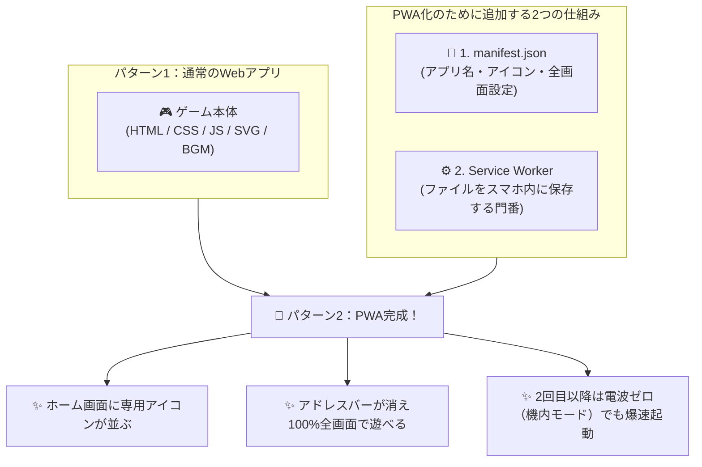
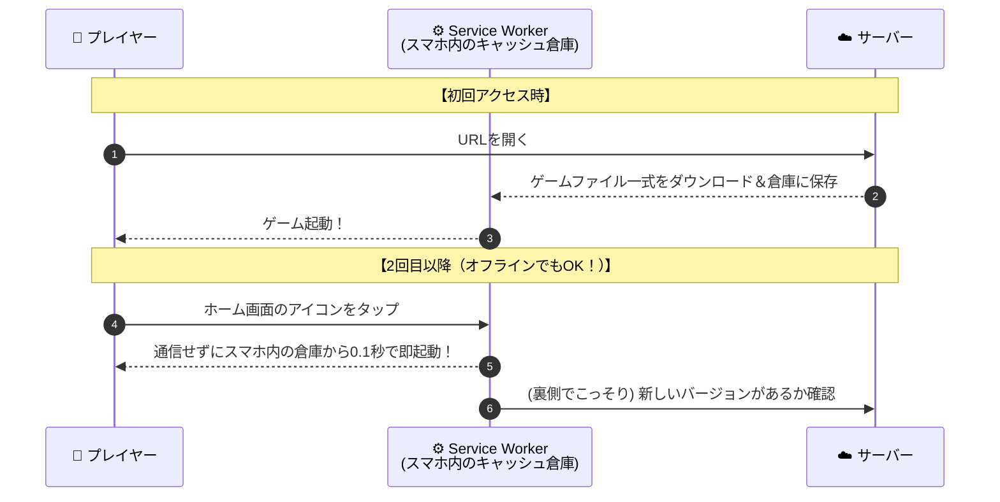

# パターン2：PWA（Progressive Web Apps）の開発・リリース完全ガイド

> **位置づけ**: メモで疑問に挙げられていた **「PWAはWebアプリ？通常アプリ？」** に対する答えは、**「中身と作り方はWebアプリなのに、スマホのホーム画面にアイコンを追加すると通常アプリ（全画面・オフライン動作）に化けるハイブリッド技術」** です。
> パターン1のWebアプリに **「たった2つの仕組み」** を足すだけで実現できます。

---

## 1. 概要と仕組み（Webアプリと何が違うのか？）

通常のWebアプリ（パターン1）には「ブラウザのアドレスバーが邪魔で画面が狭い」「電波がないと遊べない」という弱点がありました。
PWAは、Webアプリに **① Web App Manifest（設定ファイル）** と **② Service Worker（裏側で動くキャッシュ管理プログラム）** の2つを追加することで、この弱点を完全に克服します。



---

## 2. PWAを実現する「2大コア技術」の具体解説

開発者が実際に用意するのは、以下の2つだけです。

### ① `manifest.json`（または `manifest.webmanifest`）
「このWebサイトをホーム画面に追加したとき、どういうアプリとして振る舞うか」をスマホOS（iOS / Android）に伝える設計書ファイル（約20行のJSON）です。

```json
{
  "name": "VOID VANGUARD - 宇宙戦闘シューティング",
  "short_name": "VoidVanguard",
  "start_url": "/",
  "display": "standalone",
  "orientation": "portrait",
  "background_color": "#070913",
  "theme_color": "#00f3ff",
  "icons": [
    {
      "src": "/icons/icon-192x192.png",
      "sizes": "192x192",
      "type": "image/png"
    },
    {
      "src": "/icons/icon-512x512.png",
      "sizes": "512x512",
      "type": "image/png"
    }
  ]
}
```
- **最重要設定 `display: "standalone"`**: これを書くことで、ホーム画面のアイコンから起動した際に**ブラウザのURLバーや下部ナビゲーションバーが完全に消え、通常アプリと見分けがつかない全画面表示**になります。
- **`orientation: "portrait"`**: スマホを傾けても画面が勝手に横向きに回転しないよう、縦画面に固定します。

### ② `Service Worker`（サービスワーカー）
ブラウザとサーバーの間に入り、ゲームに必要なファイル（HTML、JS、Stitchのキャラ画像、BGMデータ等）を**スマホの内部ストレージに丸ごとキャッシュ（保存）するプログラム**です。



---

## 3. 開発の進め方（ステップ・バイ・ステップ）

パターン1（Webアプリ）の開発フローに、以下の3ステップを足すだけでPWAになります。

### Step 1: アプリアイコン画像の作成
ホーム画面に表示される正方形のアイコン画像（`192×192px` と `512×512px` のPNG画像、および iPhone用の `apple-touch-icon.png`）を用意します。

### Step 2: PWAプラグインの導入（自動生成の活用）
Service Worker を手書きするとキャッシュ更新の管理が大変ですが、ビルドツール **Vite** の公式プラグイン（`vite-plugin-pwa`）を使えば、設定を数行書くだけでビルド時に `manifest.json` と `Service Worker` を**完全自動で生成**してくれます。

### Step 3: スマホの全画面「セーフエリア（ノッチ領域）」対応
PWAをホーム画面から全画面（`standalone`）起動すると、iPhone上部のカメラ部分（ダイナミックアイランド／ノッチ）や下部のホームバー領域までゲーム画面が広がります。
- Stitchの [`DESIGN.md`](../images/stitch/void_vanguard/DESIGN.md) にも記載があった通り、スコア表示やボムボタンがノッチに隠れないよう、CSSの `env(safe-area-inset-top)` / `env(safe-area-inset-bottom)` を使って上下に安全な余白（セーフエリア）を確保します。

---

## 4. リリースの進め方と「ユーザーへの届け方」

### サーバーへの公開手順
- **パターン1（Webアプリ）と100%同じ**です。Cloudflare Pages や Vercel に `git push` するだけで、自動的にPWAとして公開されます（AppleやGoogleの審査・登録費用は一切不要です）。
- ※PWAはセキュリティ上の仕様により **HTTPS通信（`https://`）が必須** ですが、Cloudflare Pages 等を使えば自動で満たされます。

### プレイヤーに「PWAとしてインストール」してもらう導線設計
PWAで一番大切なのは、**「ただURLを開いたプレイヤーに、どうやってホーム画面へ追加してもらうか」** の案内（UI）をゲームタイトル画面に入れておくことです。Android と iPhone で挙動が異なります。

| OS / ブラウザ | インストールの仕組み | ゲーム側で作るおすすめの案内UI |
| :--- | :--- | :--- |
| **Android (Chrome)** | プログラムから直接インストール確認画面を呼び出せる（`beforeinstallprompt` イベント） | タイトル画面に **「📲 アプリとしてインストール」ボタン** を置き、タップするとワンタッチでホーム画面に追加されるようにする。 |
| **iPhone (Safari)** | Appleの仕様上、ワンタッチ追加ボタンは出せないため、ユーザー自身にブラウザの「共有ボタン［↑］→ ホーム画面に追加」を押してもらう必要がある | ブラウザ表示中のみ、画面下部に **「［↑］共有ボタンから『ホーム画面に追加』すると全画面で快適に遊べます！」という図解ポップアップ** を出す。 |

### バージョンアップ（更新）の届け方
開発者が新しいステージやバグ修正を `git push` すると、次回プレイヤーがアプリを起動した際、Service Worker が裏側で新バージョンを検知します。
- タイトル画面で「新しいアップデートがあります。再読み込みしますか？」と表示してタップしてもらう（または次回起動時に自動反映する）ことで、常に最新版を届けられます。

---

## 5. 3大評価軸での詳細分析（コスト・利便性・セキュリティ）

### ① 開発側の対応コスト：【◎ 非常に低い（コスパ最強）】
- **金銭コスト**: **0円**（ストア登録料なし、サーバー代無料）。
- **追加工数**: パターン1（Webアプリ）に **＋数時間〜半日程度の設定** を足すだけで完成する。
- **1つのコードで両方成立**: 「URLを開くだけでそのままWebアプリとして遊ぶ人」と「ホーム画面に追加してPWAとして遊ぶ人」の**両方に1つのサイトで同時対応**できる。

### ② 利用者側の利用しやすさ：【◎ 快適性・没入感が劇的に向上】
- **メリット**:
  - **全画面の没入感**: アドレスバーが消えるため、宇宙空間のシューティング画面をスマホ縦画面いっぱいに使える。
  - **誤操作防止**: 激しいスワイプ操作をしても、ブラウザの「戻る」や「タブ切り替え」が暴発しにくくなる。
  - **オフライン対応＆通信量節約**: 一度開けば画像やBGMがスマホに保存されるため、ギガ（通信量）を消費せず、電波のない場所でもサクサク遊べる。
- **デメリット**:
  - App Store や Google Play で検索しても出てこない（URLやQRコードからアクセスしてもらう必要がある）。
  - iPhoneユーザーには「共有 → ホーム画面に追加」の操作を案内する必要がある。

### ③ セキュリティ対策：【◯ Webアプリと同等＋キャッシュ保護】
パターン1のセキュリティ対策に加え、PWA特有の以下のポイントを押さえます。
1. **HTTPSの強制**: Service Worker は `https://` 環境でしか動作しないようブラウザ側で厳格に保護されているため、通信経路での改ざん（中間者攻撃）は防がれます。
2. **キャッシュの安全な更新**: 万が一バグのあるバージョンをキャッシュさせてしまっても、すぐに修正版へ差し替えられるよう、Service Worker の更新戦略（`registerType: 'autoUpdate'` または更新プロンプト表示）を正しく設定します。
3. **端末内データの消失対策**: iPhone (iOS) では「ホーム画面に追加していない通常のSafariタブ」のままだと、7日間アクセスしないだけで `localStorage` のセーブデータがOSによって自動消去される仕様（ITP制限）があります。しかし **PWAとしてホーム画面に追加してもらえば、セーブデータが長期保持されやすくなる** という大きなメリットもあります。
