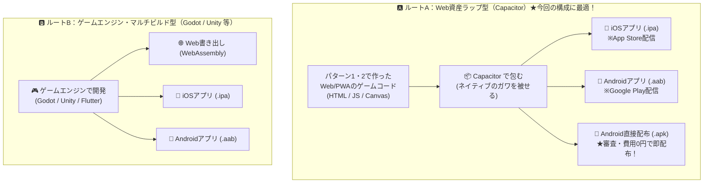
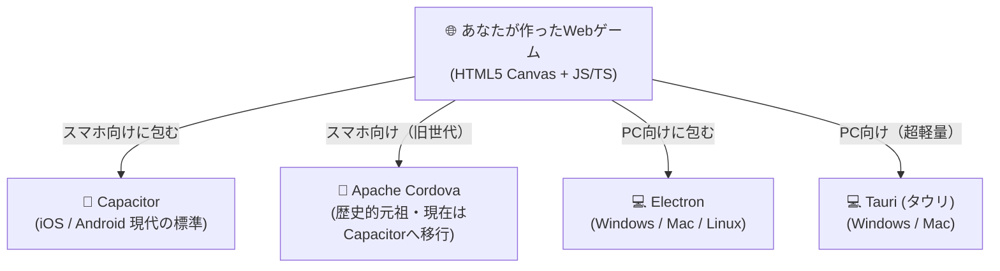
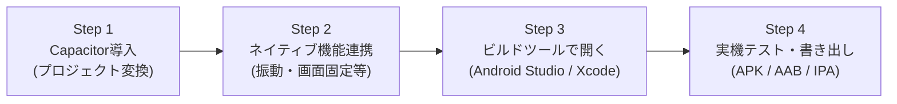
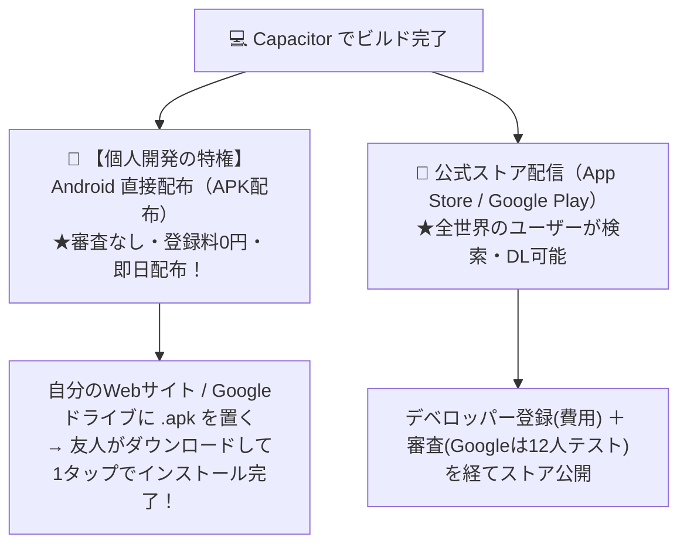

# パターン3：通常アプリ（App Store / Google Play ストア配信型 ＆ Android直接配布）の開発・リリース完全ガイド

> **位置づけ**: iPhone の「App Store」や Android の「Google Play ストア」で配信する形態、および **Android の特権である「ストアを通さないAPK直接配布（サイドローディング）」** を行う形態です。
> Web/PWAで作ったゲームのロジック（Canvas / SVG / BGM / 当たり判定等）を **1行も書き換えることなく100%流用** してアプリ化できます。

---

## 1. 概要と仕組み（通常アプリを作る2つのルート）

「Webアプリ／PWA」と「通常アプリ」の両方を作りたい場合、別々にゼロから2回プログラムを書くのは大変です。そのため、現代の開発では以下の **ルートA（Web資産ラップ型）** または **ルートB（専用エンジン型）** のどちらかを選びます。

### ルートAとルートBの比較

| 比較項目 | 🅰️ ルートA：Capacitor（Webラップ型） | 🅱️ ルートB：Godot / Unity（ゲームエンジン型） |
| :--- | :--- | :--- |
| **仕組み** | スマホアプリの中に「見えない専用ブラウザ（WebView）」を埋め込み、その上でパターン1・2のWebゲームを動かす。 | C#（Unity）や GDScript（Godot）でゲームを作り、iOS用・Android用・Web用にそれぞれ変換（コンパイル）して書き出す。 |
| **今回の企画との相性** | **◎ 最高**。Stitchで作ったHTML/SVG資産や、Webアプリ・PWAで作ったコードを**99%そのまま使い回して通常アプリ化**できる。 | ◯ 良いが、StitchのHTML/CSS/SVGをそのまま使うことはできないため、エンジン内でUIや図形を作り直す必要がある。 |
| **Web版の軽さ** | **◎ 超軽量**（数MB以下で1秒起動）。 | △ エンジン本体をダウンロードするため、Web版は初回起動に数秒〜十数秒のロードが入る。 |
| **3Dや超大規模処理** | △ 2Dシューティングなら余裕で60fps出るが、本格3Dゲームには不向き。 | **◎ 大規模2D/3Dや高度な物理演算に強い**。 |

---

## 2. 開発者が知っておくべき「変換ツール」の比較（Electron との違い）

「Webアプリを通常アプリに変換するツール」として有名な **Electron** や **Cordova** との違いを整理します。

### ツール比較表：なぜスマホには Capacitor 一択なのか？

| ツール名 | 主な対象プラットフォーム | 内部の仕組み | 特徴・使い分け |
| :--- | :--- | :--- | :--- |
| **Capacitor** （★スマホ向け標準） | **iOS / Android** （Web/PWAも可） | OS標準の **WebView**（軽量部品）を利用 | **スマホ向けアプリ化の現代標準**。アプリサイズが数MB〜十数MBと極めて軽量。TypeScriptやViteとの相性が抜群。 |
| **Electron** （★PCデスクトップ専用） | **Windows / Mac / Linux** （※スマホ不可） | **Chromium（ブラウザ全体）＋ Node.js** を内包 | **スマホには非対応**。巨大なブラウザを丸ごと内包するため容量が100MB前後と重い。VS CodeやDiscord、PCゲーム（Steam）等のPC向け用途で活躍。 |
| **Apache Cordova** （旧 PhoneGap） | iOS / Android | OS標準の **WebView** を利用 | スマホ変換の歴史的元祖。設計が10年以上前で古く、現代の開発ツールと噛み合わせにくい。**開発元のIonic社自身がCapacitorへの移行を完全推奨**している。 |
| **Tauri (タウリ)** | Windows / Mac （スマホ対応は進化中） | OS標準ブラウザ部品を利用（Rust製） | Electronの「重い」という弱点を克服したPC向け新世代ツール。将来PC版を軽く出したい場合に有力。 |

> **💡 将来のマルチ展開メモ**:
> 今回作るWebゲームは、スマホ向けには **Capacitor** で包んでアプリ化しますが、将来「PCゲーム（Steam等）でも出したい！」となった場合は、ゲームコードを1文字も変えずに **Electron や Tauri** で包むだけで、PC版（Windows `.exe` / Mac用アプリ）としても同時にリリース可能です！

---

## 3. 開発の進め方（Capacitor を使う場合のステップ）

パターン1・2で完成したWeb/PWAのプロジェクトを、Capacitor を使って通常アプリに変換する手順です。

### Step 1: 開発機材と専用ソフトの準備
- **Android アプリを作る場合**:
  - **Windows または Mac** ＋ 無料ソフト **「Android Studio」** が必要です。
- **iOS (iPhone) アプリを作る場合**:
  - Appleの規約・技術仕様上、**原則として「Mac本体」＋ 無料ソフト「Xcode」が必須**です（※Windows環境の場合は、Android版を先行させるか、クラウドMacビルドサービスを活用します）。

### Step 2: Webプロジェクトへの Capacitor 組み込み
既存のWebゲームのフォルダで、以下のコマンドを実行するだけです。
1. `npm install @capacitor/core @capacitor/cli`（Capacitorの導入）
2. `npx cap add android` / `npx cap add ios`（Android用・iOS用のネイティブプロジェクトフォルダが自動生成される）
3. `npm run build && npx cap sync`（Webゲームの最新ビルドをアプリ側に流し込む）

### Step 3: 通常アプリならではのネイティブ調整
Webブラウザではできなかった「ネイティブアプリ専用の機能」をプラグイン数行で追加できます。
- **ステータスバーの完全非表示**: スマホ最上部の時計やバッテリー表示すら消して、完全なゲーム画面にする（`@capacitor/status-bar`）。
- **触覚フィードバック（Haptics / 振動）**: 自機が被弾した瞬間やボス撃破時に、スマホのバイブレーションを「ブルッ！」と細かく震わせて手触りを劇的に良くする（`@capacitor/haptics`）。
- **バックグラウンド制御**: プレイ中に電話がかかってきたりホーム画面に戻ったりした際、自動的にゲームをポーズ（一時停止）し、BGMを止める（`@capacitor/app`）。

---

## 4. リリースの進め方（2つの配布ルート）

通常アプリを世に出す方法には、**「① 公式ストア配信」** と、**「② Android限定の直接配布（サイドローディング）」** の2通りがあります。

---

### ルート①：【個人開発・検証に超おすすめ】Android 直接配布（APKサイドローディング）

AndroidはオープンなOSであるため、**Google Play ストアを通さずに、完成したアプリファイル（`.apk`）を直接プレイヤーに配ってインストールしてもらうことが可能**です。

#### メリット（なぜ個人開発で最強なのか？）
1. **完全無料（0円）**: Googleへの登録料（25ドル）が一切不要。
2. **審査・待ち時間ゼロ**: 書き出したその瞬間に誰にでも配れる。
3. **「12人×14日間のテスト義務」を完全回避**: 2023年末にGoogle Play個人アカウントへ導入された厳しい制限を気にする必要がありません。
4. **アップデートも超簡単**: 新しい `.apk` ファイルを渡せば、セーブデータを消さずに上書きアップデートできます。

#### プレイヤーへの届け方とインストール手順
1. Android Studio から `Build APK(s)` を実行し、`app-debug.apk`（または署名済み `.apk`）を生成する。
2. そのファイルを、自分のWebサイト（Cloudflare Pages等）、Googleドライブ、Dropbox、あるいはメールやLINEで友人に送る。
3. 相手のスマホでダウンロードリンクをタップする。
4. 初回のみ、Androidのセキュリティ画面で **「提供元不明のアプリのインストールを許可しますか？ → 許可する」** を1回ONにするだけで、ホーム画面にアプリがインストールされます。

> **※iPhone (iOS) で直接配布ができない理由**:
> Appleは「ウォールドガーデン（閉じた庭）」という思想をとっており、原則として App Store 以外からのアプリ導入を禁止しています（※開発者用の特殊なテスト枠はありますが、有効期限が短かったり年1.5万円の契約が必要です）。そのため、直接配布は **Android ならではの絶大な特権** です。

---

### ルート②：公式ストア配信（App Store / Google Play）

全世界の見知らぬユーザーに届けたい場合の正規ルートです。

#### 1. デベロッパーアカウントの登録と費用

| ストア | 登録費用 | 特徴・注意点 |
| :--- | :--- | :--- |
| **Google Play Console** （Android用） | **25米ドル（約3,800円）** ※初回1回ポッキリ（年会費なし） | 費用は安いが、**個人アカウントは本番公開前に「最低12人のテスターを集め、14日間クローズドテストを実施する」という必須要件**がある。 |
| **Apple Developer Program** （iOS / iPhone用） | **年額 99米ドル（毎年 約15,000円）** ※毎年更新が必要 | 12人テストのような条件はないが、**毎年約1.5万円の維持費**がかかる（更新を止めるとストアからアプリが消える）。またMacが必須。 |

#### 2. ストア公開までのステップ
1. **電子署名（コードサイニング）**: 「開発者本人が作った改ざんされていないアプリ」であることを証明する鍵（Keystore / 証明書）を作成し、ファイルに焼き付ける（Androidは `.aab`、iOSは `.ipa`）。
2. **ストア掲載情報の準備**:
   - プライバシーポリシーのURL（1ページでOK）
   - スクリーンショット画像（プレイ画面数枚）
   - 年齢レーティング（アンケートに回答）
3. **審査提出**:
   - 提出後、数日〜1週間ほどで審査が行われます。審査を通過すれば、世界中の人がストア検索からダウンロードできるようになります。

---

## 5. 3大評価軸での詳細分析（コスト・利便性・セキュリティ）

### ① 開発側の対応コスト
- **Android 直接配布の場合**: **【◎ 0円・工数最小】**。Webアプリが完成していれば、Capacitorでビルドして数時間でAPKを配れる。
- **公式ストア配信の場合**: **【△ 高い】**。Apple年会費（約1.5万円）やGoogle登録料、Googleの「12人テスト」、ストア審査対応など事務的負荷が大きい。
- **プログラムの再利用性**: どちらのルートでも、**Capacitor を使えばWeb/PWAのコードを100%流用できるため、ゲームプログラミング自体の二度手間はゼロ**。

### ② 利用者側の利用しやすさ
- **Android 直接配布**: ダウンロード時に「提供元不明の許可」を1度押す必要があるが、ストアを経由せずリンクから即座にダウンロードできる。
- **公式ストア配信**: 「ストア公式アプリ」という絶大な安心感・信頼感がある。ストア内検索で見つけてもらえる。

### ③ セキュリティ対策：【◎ 3パターンの中で最も強固】
1. **ソースコード・アセットの保護**: Webと違ってパッケージ化・保護領域に格納されるため、一般ユーザーがF12キー等でコードを覗き見ることはできない。
2. **OSレベルの改ざん防止**: 電子署名により、悪意ある第三者によるアプリの改造・海賊版再配布がOSによって遮断される。
3. **セーブデータの恒久保持**: ブラウザのキャッシュクリア等でデータが消える心配がなく、端末内のセキュアストレージ（必要に応じてGoogle Play Games / iCloud クラウドセーブ）に安全に保存できる。
