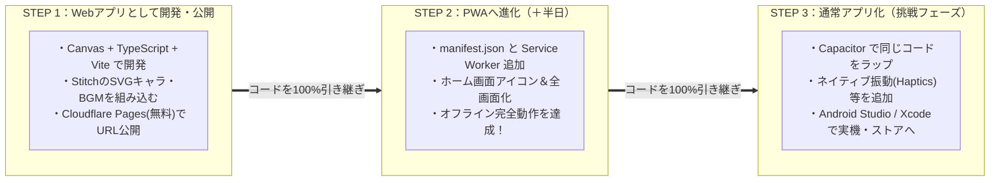

# ゲームの届け方（開発・リリース3パターン）総合まとめ＆戦略ガイド

本ディレクトリは、スマホ向けシューティングゲームを開発しプレイヤーに届けるための **3つのパターン（① Webアプリ / ② PWA / ③ 通常アプリ）** について、開発の進め方・リリースの進め方・コスト・利便性・セキュリティを体系的にまとめたナレッジベースです。

---

## 📚 1. パターン別 詳細ガイド一覧（ファイルリンク）

それぞれの具体的な開発手順・リリース工程・セキュリティ対策は以下の個別ファイルに詳しくまとめています。

| パターン | ドキュメントリンク | 一言での特徴・位置づけ |
| :--- | :--- | :--- |
| **① Webアプリ** | **[`01_web-app.md`](./01_web-app.md)** | **【すべての土台】** URLをタップするだけで1秒で遊べる。開発・公開コスト0円。 |
| **② PWA** | **[`02_pwa.md`](./02_pwa.md)** | **【コスパ＆没入感の本命】** Webアプリに2つの設定を足すだけで、ホーム画面アイコン化・全画面・オフライン動作を実現。 |
| **③ 通常アプリ** | **[`03_native-app.md`](./03_native-app.md)** | **【アプリ化・2大ルート】** ・**Android直接配布（APK）**: 審査・費用0円で即日配布可能！ ・**公式ストア配信**: App Store / Google Play で世界配信。CapacitorでWeb資産を100%流用。 |

---

## 📊 2. 3パターン徹底比較マトリクス（開発者視点）

開発者が意思決定を行うための全項目比較表です。

| 比較項目 | ① Webアプリ | ② PWA（ホーム画面追加型） | ③ 通常アプリ（Capacitor利用） |
| :--- | :--- | :--- | :--- |
| **正体（仕組み）** | ブラウザ上で動くWebページ | **Webアプリ＋全画面・キャッシュ機能** | OSに直接入れるネイティブパッケージ |
| **ベースの開発言語** | HTML5 Canvas + TS/JS | 同左（`manifest.json` + `SW` を追加） | **同左（Capacitorで包むだけで100%流用）** |
| **Stitch素材（SVG/HTML）の活用** | **◎ 100%そのまま使える** | **◎ 100%そのまま使える** | **◎ 100%そのまま使える** |
| **開発・維持の金銭コスト** | **0円**（Cloudflare Pages等） | **0円**（同左） | **・Android直接配布（APK）: 0円** ・Google Play: 初回約3,800円 ・Apple: 年額約15,000円＋Mac必須 |
| **リリース審査・手続き** | **審査なし（即日・数秒で公開）** | **審査なし（即日・数秒で公開）** | **・Android直接配布: 審査なし・即配布** ・ストア配信: 審査あり（Googleは12人テスト必須） |
| **アップデート反映速度** | `git push` で即時反映 | `git push` で即時〜次回起動時反映 | ・APK直接配布: 新しいファイルを渡すだけ ・ストア配信: 再審査（1〜数日） |
| **スマホ画面の広さ（没入感）** | △ 上下にブラウザのバーが残る | **◎ バーが消え100%全画面表示** | **◎ ステータスバーも消せる完全全画面** |
| **オフラインプレイ（電波なし）** | × 不可（毎回通信が必要） | **◎ 可能（スマホ内に全データ保存）** | **◎ 可能（最初から端末内に保存）** |
| **プレイヤーの導入ハードル** | **◎ 最高に手軽（URLタップのみ）** | ◯ URLで即遊べ、気に入ればホーム追加 | ・APK: DL後「許可」を押すだけ ・ストア: ストアから通常ダウンロード |
| **セキュリティ（コード保護・改ざん耐性）** | ◯ HTTPS保護あり（JS難読化で対策） | ◯ HTTPS必須＋ローカル保持強化 | **◎ パッケージ署名・保護領域により最高強度** |

---

## 🚀 3. 推奨ロードマップ：「1つのコードで3段階すべてを制覇する」黄金ルート

メモにあった **「Webアプリ / PWA / 通常アプリを制作したい」「開発技術を段階的に習得したい」** という目的に対し、最初から別々に作るのではなく、**1つのソースコードを育てながら3段階に進化させる進め方（プログレッシブ・デリバリー戦略）** が圧倒的におすすめです。

### なぜこの「3段階ロードマップ」がベストなのか？
1. **手戻り（作り直し）がゼロ**:
   - STEP 1 で書いたシューティングゲームのプログラムや Stitch のキャラクター描画コードが、STEP 2（PWA）でも STEP 3（通常アプリ）でも**そのまま100%動きます**。
2. **最速で「遊んでもらえる喜び」を得られる**:
   - 通常アプリのストア審査（Googleの14日間テスト等）から始めると、誰かに遊んでもらうまでに何週間もかかってしまいます。
   - STEP 1・2（Web＋PWA）なら、**作ったその日にURLやQRコードを発行して、自分のスマホや友人のスマホで全画面プレイ**を楽しめます。
3. **コストとリスクを自分でコントロールできる**:
   - STEP 2（PWA）までなら**完全無料（0円）**で「ホーム画面にアイコンが並び、全画面・オフラインで動くアプリ」が手に入ります。
   - その完成度を見てから、「よし、ストアにも出してみよう！」と思ったタイミングで STEP 3（デベロッパー登録・課金）に進むことができます。

---

## 🛡️ 4. セキュリティ設計のまとめ（今回のゲームでやるべきこと）

今回のシューティングゲーム（1人プレイ・宇宙戦闘）において、開発コストをかけすぎずに十分な安全性を確保する**「現実的なセキュリティチェックリスト」**です。

| レベル | 対策項目 | 具体的なやり方（対応コスト） | 対象フェーズ |
| :--- | :--- | :--- | :--- |
| **必須（基本）** | **① 全通信のHTTPS化** | Cloudflare Pages / Vercel を使えば**設定不要（自動）**で最高ランクの暗号化通信になる。 | STEP 1〜 |
| **必須（基本）** | **② 秘密情報の非同梱** | ゲームのコード内にパスワードや有料APIキーなどを一切書かない（完全フロントエンド完結にする）。 | STEP 1〜 |
| **推奨（標準）** | **③ コードの圧縮・難読化** | Vite の本番ビルド（Minify）＋必要に応じて難読化プラグインを入れ、F12で覗かれても簡単に解読・改造できないようにする。 | STEP 1〜 |
| **推奨（標準）** | **④ セーブデータの署名検証** | ハイスコアやステージ解放状況を `localStorage` に保存する際、チェック用のハッシュ値を付与し、単純な数値書き換えを無効化する。 | STEP 2〜 |
| **将来拡張時** | **⑤ オンラインランキング保護** | もし将来「全国スコアランキング（サーバー通信）」を追加する場合は、スコア送信時にプレイログ検証やレート制限（連投防止）を入れる。 | 拡張時のみ |
