# ゲーム企画方針書（game-design.md）

> **文書の位置づけ**: 本企画方針書は、宇宙シューティングゲームの開発における「生きた設計図（Living Document）」です。対話を通じて仕様や方針が決まるたびに適宜更新し、常に最新のゲームデザインをここに集約・記録します。

- **プロジェクト名（仮題）**: `VOID VANGUARD（ボイド・ヴァンガード）`
- **ジャンル**: 宇宙サイバーパンク・縦スクロールシューティング
- **対応プラットフォーム**: スマホ前提（Webアプリ ＆ PWA ＆ Android APK直接配布）
- **作成日**: 2026-11-15
- **ステータス**: 企画・仕様策定中（Active）

---

## 1. ゲームコンセプト ＆ コアループ

### 1.1 基本コンセプト
- **「宇宙の深淵を駆け抜ける、スタイリッシュ＆ハイスピード迎撃戦」**
- サイバーパンク×アーケードHUDの世界観（Stitch デザインシステム準拠）で、迫り来る敵機甲師団と全10戦域の巨大ボス艦隊を撃破していく王道STG。
- スマホ縦持ちで、いつでもどこでも片手でサクッと遊べ、やればやるほど上達を実感できるゲームデザイン。

### 1.2 コアループ（Core Loop）

---

## 2. プレイ環境 ＆ 配信（届け方）方針

開発コスト・手軽さ・セキュリティを両立するため、**1つのソースコードから3段階に進化させる「プログレッシブ・デリバリー」** を採用する。（詳細は [`docs/delivery-patterns/`](./docs/delivery-patterns/README.md) 参照）

| 形態 | 役割・届け方 | コスト・審査 |
| :--- | :--- | :--- |
| **① Webアプリ版** | URL / QRコードをタップするだけでブラウザ上で即座に遊べる初期形態。 | 費用0円 / 審査なし |
| **② PWA版（本命）** | 「ホーム画面に追加」することで、ブラウザのバーが消え100%全画面・オフラインで動作。 | 費用0円 / 審査なし |
| **③ Android直接配布（APK）** | ストアを介さず `.apk` ファイルを直接配布。Google Playの「12人テスト義務＋25ドル」を完全回避して通常アプリ化。 | 費用0円 / 審査なし |
| **④ ストア配信（将来挑戦）** | 完成度を高めた後、Capacitorで包んで App Store / Google Play での全世界配信に挑戦。 | ストア登録料・審査あり |

---

## 3. 画面設計 ＆ 操作性仕様

詳細は [`docs/04_screen-and-character-sizing.md`](./docs/04_screen-and-character-sizing.md) を基準とする。

### 3.1 基準仮想解像度
- **`360 × 640`（縦横比 9:16）**: どのスマホ画面でも比率を固定して自動拡大・縮小。

### 3.2 画面縦3分割レイアウト
- **上部 HUD エリア（0〜50px）**: スコア、残機（3機）、HPゲージ、ボム保有数を常時表示。
- **メイン戦闘エリア（50〜400px）**: 敵の出現、ボス配置、弾幕展開。プレイヤーの指が入らないため視界クリア。
- **プレイヤータッチ＆回避エリア（400〜640px）**: 指のスワイプ操作および自機の移動空間。

### 3.3 スマホ特有の操作性（ゲームフィール）
- **オートショット**: 画面に触れている間（または常時）、前方に弾が自動連射されるため、プレイヤーは「移動・回避」に集中できる。
- **指隠れ防止（タッチオフセット）**: 自機はタッチしている指の位置より **`50px` 上方** を追従飛行し、自機周辺の弾幕が指で隠れないようにする。
- **当たり判定（複合円判定 / マルチサークル）**: 自機の見た目（38×44px）のシルエットに合わせ、**機首（半径 `5px`）・胴体（半径 `7px`）・左翼（半径 `6px`）・右翼（半径 `6px`）の4つの円**を組み合わせて判定。機体周りの何もない空間では当たらず、機体や翼にかすった時は正確に被弾する納得感のあるバランスを実現。

---

## 4. 自機（Player Craft） ＆ パワーアップ仕様

### 4.1 自機基本ステータス
- **基本機体**: `VF-01 VALKYRIE`（バランス型・標準突撃機）
- **残機システム**: **3機**（全滅でゲームオーバー）
- **ライフシステム**: 1機あたり **シールド/HP制**（1発即死ではなく、数発の被弾に耐えられる初心者安心設計）

### 4.2 パワーアップ・オプション体系
敵を倒すと出現するカプセル・キューブを取得して強化する。
- **ドロップバランス**: 通常ザコからは敵の強さに応じた控えめな確率（`SCOUT: 8%` / `INTERCEPTOR: 12%` / `SPREADER: 18%`）で出現し、貴重品（ボム・回復）は主に中型ガンシップ・ボス撃破の確定報酬（2個）として入手する。また、スピード最大到達後はスピードアップを抽選対象から除外する。

1. **スピード調整**:
   - **スピードアップ（Speed Up）**: 自機の移動速度が1段階上昇（最大3段階）。
   - **スピードダウン（Speed Down）**: 速度が出すぎて制御しづらい時用に減速できる。
2. **メイン武器（3系統 × 5段階レベル強化）**:
   - **通常弾（バルカン / レーザー）**: 直線上に高威力の弾を連射。レベルアップで弾数増加（1way → 3way → 5way → 収束レーザー）。
   - **ミサイル（拡散・爆発型）**: 前方斜め方向に発射され、着弾時に爆風で周囲の敵を巻き込む。
   - **ホーミングレーザー（自動追尾型）**: 敵を自動索敵してカーブしながら突進する誘導兵器。ザコ編隊の掃討に最適。
3. **緊急回避兵器（ボム）**:
   - 画面上のボムボタンタップで発動。画面全体の敵弾を消滅させ、敵全体に大ダメージ（無敵時間付与）。

---

## 5. 難易度設計（3段階）

プレイヤーの腕前に合わせてタイトル画面で選択可能。

| 難易度 | 特徴・ゲームバランス |
| :--- | :--- |
| **Easy** | 敵の耐久力が低く、敵弾の速度が遅い。被弾時のシールド減少が少なく、リラックスして全10ステージをクリアできる。 |
| **Normal** | 標準バランス。適度な弾幕とスピード感があり、アイテムをしっかり取って強化していく楽しさを味わえる。 |
| **Hard** | アーケードSTG並みの手応え。敵弾の密度と速度が大幅に上がり、敵を撃破した瞬間に「撃ち返し弾」が発生する上級者モード。 |

---

## 5.5 通常敵（ザコ・中型敵）キャラクター仕様

道中（45秒のスクロール区間）に登場する敵機を 4 タイプに分類し、形状・色・移動パターン・撃ってくる弾を差別化する。

| タイプ | 機体名称 | 見た目・色 | 基本HP | 移動挙動 | 攻撃（撃ってくる弾） |
| :--- | :--- | :--- | :--- | :--- | :--- |
| **SCOUT** | **偵察ドローン** (`SCOUT DRONE`) | 小型V字型（クリムゾン赤） | 2 | 左右に揺れながらゆっくり下降 | **自機狙い単発弾**（赤丸） |
| **INTERCEPTOR** | **突進インターセプター** (`DART RAIDER`) | 細長デルタ型（警告イエロー） | 1 | 画面上部で一瞬静止し、**自機方向へ急降下突進** | **弾は撃たない**（体当たり特化） |
| **SPREADER** | **拡散スプレッダー** (`TRI-SPREADER`) | ワイド菱形（バイオレット紫） | 3 | 画面上部（Y=90〜160）でホバリングし左右往復 | **3-way 扇状拡散弾**（紫丸・広角） |
| **GUNSHIP** | **重装甲中型ガンシップ** (`TITAN GUNSHIP`) | 大型六角装甲（ダークオレンジ） | 75 | 中盤（25秒付近）に出現し画面上部中央で停止 | **交差ガトリング ＋ 自機狙い弾**（倒すと確定2アイテムドロップ） |

### 道中タイムライン（ステージ別スクロール時間とウェーブ構成）
1. **0〜5秒（導入）**: `SCOUT`（偵察ドローン）が飛来（Stage 2 以降は開幕から強い敵も混在）。
2. **5秒〜ボス戦前（波状攻撃）**: `INTERCEPTOR`（急降下）と `SPREADER`（3-way拡散）が主軸となって次々に出現。
3. **中盤・終盤の山場**: 中型敵 `GUNSHIP` が複数回（Stage 1: 18秒・33秒付近 / ステージ上昇で最大4回）出現。
4. **ステージ上昇による変化**:
   - **スクロール距離の延長**: Stage 1 は **45秒**、以降ステージごとに **+5秒** ずつ長くなり、Stage 10 は **90秒** の大決戦ステージへ成長する。
   - **密度と編成の強化**: 強い敵の割合が増え、1回の出現で 2〜3機同時に編隊を組んで飛来するようになる。
5. **規定時間到達〜（ボス戦）**: `WARNING` 警報とともにステージボスが登場。

---

## 6. 全10ステージ構成 ＆ ボス艦隊一覧

Stitch アセット（`stage_1_10`）のデータを完全準拠し、戦域とボスを設定。

```mermaid
flowchart LR
    S1["ST.01 GOLIATH<br/>(低軌道要塞)"] --> S2["ST.02 MANTA<br/>(成層圏爆撃機)"]
    S2 --> S3["ST.03 CENTIPEDE<br/>(小惑星帯百足)"]
    S3 --> S4["ST.04 IRON AEGIS<br/>(防衛要塞)"]
    S4 --> S5["ST.05 HELIOS<br/>(恒星観測炉)"]
    S5 --> S6["ST.06 ABYSS<br/>(暗黒星雲生命体)"]
    S6 --> S7["ST.07 OUROBOROS<br/>(時空歪曲兵器)"]
    S7 --> S8["ST.08 CRUCIBLE<br/>(超弩級主砲艦)"]
    S8 --> S9["ST.09 ZERO<br/>(特異点兵器)"]
    S9 --> S10["ST.10 DEUS EX COSMOS<br/>(神性機動超越生命体)"]
```

| ステージ | 戦域（セクター） | ボス名 | 基本HP (Normal) | 弾カラー | 固有弾幕・ギミック（通常 / 怒り時 HP50%以下） |
| :--- | :--- | :--- | :---: | :--- | :--- |
| **ST.01** | 低軌道宇宙ステーション | **GOLIATH** | 320 | 赤 (`#ff0055`) | 左右ガトリング交差3-way ＋ 自機狙い3連弾（怒り時 5-way化） |
| **ST.02** | 成層圏・上層大気 | **CRIMSON MANTA X-2** | 450 | 橙 (`#ff6600`) | 高速滑空 ＋ 4方向分裂クラスター爆弾 ＋ 高速直線弾（怒り時 2発同時投下・6方向分裂） |
| **ST.03** | 第4小惑星帯 | **SUB-SPACE CENTIPEDE** | 600 | 紫 (`#b829ff`) | うねる移動 ＋ 全方位リング弾 ＆ 蛇行波弾（HP低下に応じて移動＆攻撃速度が加速） |
| **ST.04** | 要塞防衛回廊 | **IRON AEGIS** | 780 | 青 (`#00d4ff`) | 回転防御オーブ ＋ 隙間からのX字クロス高速連弾 ＋ 扇状防衛弾（怒り時 2連射・高密度化） |
| **ST.05** | 恒星フレア接近域 | **SOLAR FLARE: HELIOS** | 980 | 黄 (`#ffcc00`) | 回転スパイラル弾幕 ＋ 予告線付き縦レーン・プラズマ熱波（怒り時 2重逆回転スパイラル） |
| **ST.06** | 暗黒星雲深宇宙 | **VOID LEVIATHAN: ABYSS** | 1200 | 緑 (`#00ff88`) | 蛇行する低速粘着弾 ＋ 高速針弾の緩急（HP 40%付近で1度だけ小規模自己再生＋触手全方位弾） |
| **ST.07** | 時空歪曲実験宙域 | **OUROBOROS** | 1450 | シアン (`#00ffff`) | 予告マーカー後の瞬間ワープ ＋ 減速後に再加速する時空トラップ弾（怒り時 残像位置からも追撃） |
| **ST.08** | 惑星破壊炉心 | **CRUCIBLE OMEGA** | 1750 | 紅 (`#ff2a6d`) | チャージ警告線からの極太主砲ビーム ＋ 両舷ミサイル弾幕（怒り時 チャージ短縮・左右交互掃射） |
| **ST.09** | 人工重力特異点 | **SINGULARITY ZERO** | 2100 | 紫紺 (`#8b5cf6`) | 自機を引き寄せる重力場 ＋ 外周へ広がる電磁リング弾（怒り時 引き寄せ強化・カーブ重力弾追加） |
| **ST.10** | 最終特異領域（神域） | **DEUS EX COSMOS** | 2600 | 金→虹 | **3形態変化**: 第1(金環交差カーテン) → 第2(2重スパイラル＋高速狙い) → 第3(極彩全画面カーテン＋星屑全方位弾) |

---

## 7. 演出・ストーリー設計（HUDブリーフィング方式）

詳細は [`docs/05_cutscene-and-story-presentation.md`](./docs/05_cutscene-and-story-presentation.md) を基準とする。
動画ファイル再生（容量肥大・自動再生制限あり）を避け、容量0KB・最高画質・高没入感の **「プログラム制御によるHUDブリーフィング（In-Engine演出）」** を採用。

### 7.0 バックグラウンドシナリオ（世界観）
- 時は近未来（西暦2184年）。多くの人類が地球外の入植惑星へ移住し生活していた中、突如として謎の地球外生命体機甲師団が侵入。
- 防衛線は次々と突破され人類が存亡の危機に瀕する中、科学の粋を結集して開発された最新鋭迎撃機が **`VF-01 VALKYRIE`**。
- 極めて高度な操縦技術を要するこの機体を御せる唯一の戦士（プレイヤー）が立ち上がり、全10戦域の突破へ挑む。

### 7.1 プロローグ（出撃ブリーフィング）
- **緊急警報演出**: 画面暗転＋赤警告帯（`EMERGENCY ALERT`）点滅＋電子アラート音。
- **作戦ブリーフィング（タイピング表示）**: 「カタカタ…」という通信音とともに、作戦司令部からの迎撃命令文が1文字ずつタイプライター風に展開。
- **機体照準ロックオン**: 自機（VF-01 VALKYRIE）のワイヤーフレーム（SVG）が回転表示され照準がロック。
- **ワープ出撃**: 「DEPLOY TO COMBAT AREA」の合図とともに星々が手前に高速流動し、シームレスにステージ1戦闘へ突入。
- **操作性**: 画面タップでタイピング即時全展開、再タップでスキップ可能。

### 7.2 ステージクリア演出（達成感 ＆ スコア集計）
- **ボス撃破フィニッシュ**: ボスHPゼロ時に一瞬スローモーション＋白光フラッシュ＋大爆発。
- **スコア・ロールアップ**: 撃破率、タイムボーナス、ノーダメージボーナスの数字が「ドゥルルル…」と高速加算。
- **ランクスタンプ**: 腕前に応じて「C / B / A / S / SSS」のクリアランクが画面中央にド派手に刻印される。

### 7.3 最終エピローグ（ステージ10走破後）
- **最終ボスの消滅**: 神性機動超越生命体 DEUS EX COSMOS が粒子となって消散し、静寂の宇宙へ。
- **凱旋メッセージ ＆ スタッフロール**: 穏やかな星空を背景に、地球防衛艦隊からのメッセージと全戦績リザルト（トータルスコア・総撃破数）が余韻あるエンディングBGMとともにスクロール。自機が地球へ帰還して終幕。

---

## 8. サウンド・BGM設計（ハイブリッド構成）

詳細は [`docs/06_sound-and-audio-design.md`](./docs/06_sound-and-audio-design.md) を基準とする。
著作権侵害リスクゼロ、容量ゼロ、発音遅延ゼロを達成するため、**「効果音はWeb Audio API合成 ＋ BGMは軽量シームレスループ音源」** のハイブリッド構成を採用。

### 8.1 効果音（SE）：Web Audio API プログラム合成（容量0KB）
- **自機ショット**: サイン波超高速周波数スイープ（880Hz ➔ 220Hz）。軽快な「ピシュン！」
- **爆発音**: ローパスフィルターをかけたホワイトノイズ減衰。「ドォン！」「ズガガガ…」
- **被弾音**: 三角波の金属打撃クラッシュ。「ガシィン！」
- **HUDタイピング＆警告音**: 短パルス矩形波。「カタカタ…」「ピピッ、ピピッ」
- **特長**: 音声ファイル不要・同時発音無制限・ミリ秒単位の遅延ゼロ。

### 8.2 BGM構成（全4トラック）
- **Track 1（出撃前夜）**: タイトル〜プロローグ用。静寂の宇宙アンビエント・シンセ。
- **Track 2（軌道突破戦）**: ステージ1〜5用。140BPM 疾走サイバーパンク・ドラムンベース。
- **Track 3（深宇宙侵攻）**: ステージ6〜9用。148BPM 緊迫ダーク・サイバーテクノ。
- **Track 4（神域決戦）**: ステージ10用。160BPM ドラマチック・シンセクワイヤEDM。

### 8.3 スマホ音声制限突破（Autoplay Policy対策）
- タイトル画面の「TOUCH TO SORTIE（出撃開始）」タップを合図に `AudioContext.resume()` を実行し、iPhone/Androidで100%確実にサウンドをアンロック。

---

## 9. UIショートカット ＆ ゲーム制御仕様

スマホの片手操作・誤操作防止、およびPC環境での快適なテストプレイ・デバッグを両立するための操作仕様。

### 9.1 スマホ画面上のタッチ操作UI
- **ポーズボタン（⏸）**: 画面右上（HUD枠内）に半透明で小さく配置。戦闘の視界を邪魔しない設計。
- **ポーズメニュー（一時停止画面）**:
  - `RESUME（再開）`: カウントダウンなしで即座に戦闘再開。
  - `RETRY（再出撃）`: 現在のステージを初期状態からやり直す。
  - `AUDIO CONFIG`: BGM / SE のミュート切り替え。
  - `ABORT MISSION（作戦中断）`: タイトル画面へ戻る（確認ポップアップ付き）。
- **バックグラウンド自動ポーズ**: スマホの着信や別アプリへの切り替え時に自動停止。
- **スキップボタン（⏩）**: プロローグ／エピローグ演出の右上に配置。1回タップで全文字表示、2回タップで即出撃。
- **ボムボタン（💣）**: 画面下部左右の親指で押しやすい位置に常設。

### 9.2 PCキーボード・ショートカット（開発・デバッグ・PCプレイ用）
| キー | 割り当て機能 |
| :--- | :--- |
| `Space` / `Enter` | ゲーム開始 / 決定 / プロローグの即時全展開・スキップ |
| `P` または `Esc` | ポーズ（一時停止 ＆ ポーズメニュー開閉） |
| `R` | クイックリトライ（即座にステージを最初からやり直す） |
| `Q` / `Backspace` | ゲーム中断（タイトル画面へ戻る） |
| `M` | オーディオミュート（BGM/SEの消音ON/OFFトグル） |
| `B` または `X` | ボム（緊急回避兵器）発動 |

### 9.3 開発用検証モード（DEV TEST MODE）
- タイトル画面およびポーズメニューの「DEV TEST」ボタンから、任意の **ステージ（ST.01〜ST.10）**、**開始フェーズ（道中開始 / ボス戦直行）**、**武器種別・武器レベル（Lv1〜Lv5）** を選択して即座に出撃・テストできる開発用検証機能を備える。

---

## 10. 企画改定履歴
- **2026-11-15（第5版）**: 全10ステージボスの固有弾幕・HPカーブ・弾カラー詳細、および「9.3 開発用検証モード」を追記。
- **2026-11-15（第4版）**: ユーザーメモ更新に基づき「9. UIショートカット ＆ ゲーム制御仕様」を追加。ポーズ・中断・スキップ・PCキーボード操作を定義。
- **2026-11-15（第3版）**: サウンド・BGM設計を正式決定。Web Audio APIによる効果音合成、全4トラックBGM構成、Autoplay対策を反映。
- **2026-11-15（第2版）**: 課題②の検討を完了。演出手法として「プログラム制御によるHUDブリーフィング演出」を正式決定し、プロローグ・ステージクリア・最終エピローグの仕様を反映。
- **2026-11-15（初版）**: 企画方針書初版作成。構想メモ、Stitch素材、届け方方針、サイズ設計、全10ステージボス構成を統合。
